# Galaxy Shader

**Photorealistic Minecraft Shader · 1.15.62 · Community Project**

**1.15.62 — low-end optimisation: a terrain fragment evaluates sun radiance once (2026-11-06):** The direct light on terrain is built from three lobes — the main diffuse term, thin-leaf transmission and a warm bounce in shadow — and all three share the same sun and moon radiance. `shadeSurface` used to call `directionalRadiance()` three times for that one value, repeating the sun-direction normalisation, the three-band atmospheric transmittance (two vector exponentials) and the moon-phase and weather factors each time. Every terrain fragment now evaluates it once and reuses it, and all three lobes stay pixel-identical. Water does the same: the body fill, the solar glint and the shore foam share one radiance, so a water fragment drops from two evaluations to one and shallow foam no longer pays a third. A call-counting probe in the synthetic GPU fixture confirms the terrain path falls from three calls per pixel to one, and the previous and new outputs match with a maximum absolute difference of exactly 0 at noon, golden hour, night, in a cave, in rain and in a storm. No option, texture, lookup or render target is added; the saving lands on terrain (which usually fills the screen) and water pixels.

**1.15.61 — the aurora fades out of twilight (2026-11-04):** The aurora belongs to the dark sky. Previously the day factor reached zero about six degrees below the horizon and the curtains and zenith corona switched on at full strength while the dome was still glowing twilight blue, so green curtains sat abruptly over a bright dusk. The aurora now fades in as the Sun drops from about 3 to 11.5 degrees below the horizon: it shows only faintly in a lit twilight sky and returns to its previous full strength once the night is truly dark. While the factor is zero the ribbons and the corona are skipped outright, which is also the most expensive stretch of the twilight sky path (several trigonometric calls, exponentials and noise). In the synthetic GPU fixture the deep night at -30 degrees and the day at +20 degrees match the previous build pixel for pixel, the deep night still draws the full aurora, the aurora call is skipped for 100% of sky pixels at -2 and 0 degrees where the previous build called it on every pixel, and the green channel drops clearly at -4.5 degrees. No option, texture, lookup or render target is added. The image below is a synthetic GPU northern-sky comparison with the Sun six degrees below the horizon, new behaviour above and the previous build below; it is not a gameplay capture.

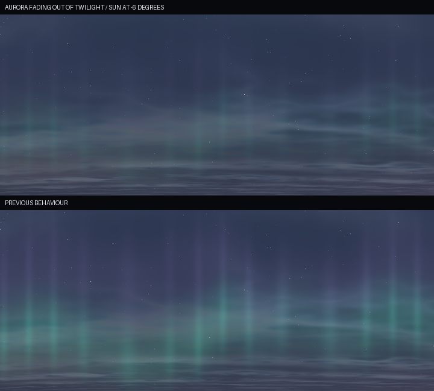

**1.15.60 — the evening star in the twilight sky (2026-11-04):** Venus is the brightest planet after the Sun and never strays more than about 47 degrees from it, so it only ever shows as a bright point in the small patch of sky after sunset or before sunrise. The sky now carries an analytic Venus point that stays above the Sun; its elongation breathes slowly between roughly 19 and 34 degrees on the day counter, its core is about 0.1 degrees wide with a 1.1 degree glow around it, and it outshines every star. Overcast and storms dim it. The gate is exactly zero when the Sun is above about 7 degrees or below about 19 degrees, so the daytime and deep-night skies are untouched and the cost lands only in the few degrees of twilight. In the synthetic GPU fixture the point appears at its analytic position with the Sun at -9 degrees and is far brighter than the previous sky, the output matches a build with the feature disabled pixel for pixel at +25 and -40 degrees, a storm clearly dims it, and repeat renders are identical. No option, texture or render target is added. The image below is a synthetic GPU sky comparison with the Sun nine degrees below the horizon, new behaviour above and the previous build below; it is not a gameplay capture.

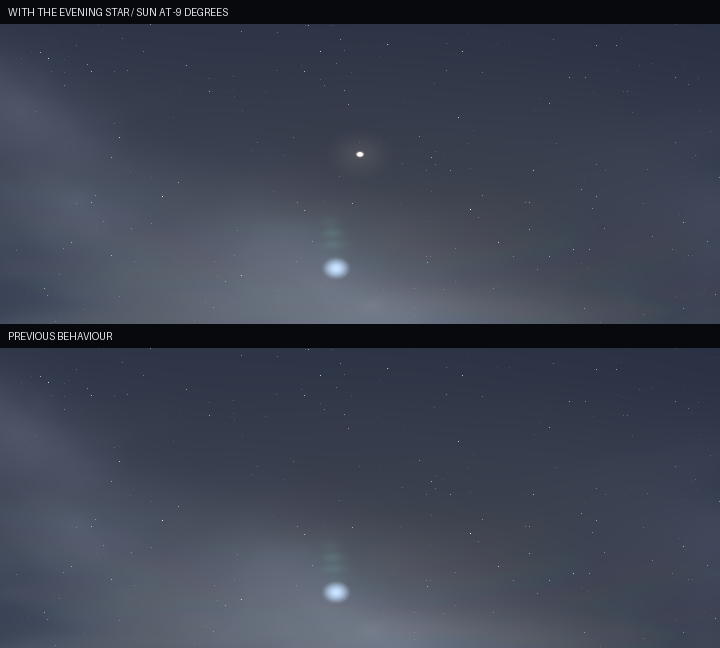

**1.15.59 — low-end optimisation: the sunlight tint is skipped at night (2026-11-04):** The three-band sunlight colour costs two vector exponentials, two luminance normalisations and two smooth blends per call. Inside the sky pass it only feeds the solar aureole, the solar disk and the ice-crystal halos, all of which are exactly zero at night, yet the shader computed the colour for every sky pixel before multiplying it away. The pass now returns a zero vector when the day factor is zero, so the whole night sky, together with the moon, stars and galaxy, skips the calculation; sunrise, dusk and noon still evaluate it. In the synthetic GPU fixture the call is skipped for 100% of sky pixels at sun elevations of -30 and -12 degrees, still evaluated at 0 and 35 degrees, and all four skies match the previous build exactly (difference 0). No option, texture, lookup or render target is added. Combined with 1.15.57, the night sky path no longer pays for daytime work at all.

**1.15.58 — stellar extinction near the horizon (2026-11-04):** A star sitting close to the horizon shines through far more air than one overhead, so scattering strips out its blue light and it dims and turns orange. The star field only had a "fainter lower down" fade and stayed cold white. Stars now carry an extinction factor keyed to view elevation: about 78% of red, 52% of green and 34% of blue get through at the horizon, returning to pure white above roughly 26 degrees. Only the star layer changes; the galaxy, aurora, moon, clouds and the sky background itself are untouched pixel for pixel. The cost is three multiplications per star-field pixel, with no new samples, trigonometry or textures. In the synthetic GPU fixture stars above 30 degrees match the previous build exactly, stars between 5 and 20 degrees gain red share and lose the most blue, the star points stay clearly visible, and repeat renders are identical. The image below is a synthetic low-star-field comparison, new behaviour above and the previous build in the middle; the third row shows the light absorbed by extinction amplified 2000 times. It is not a gameplay capture.

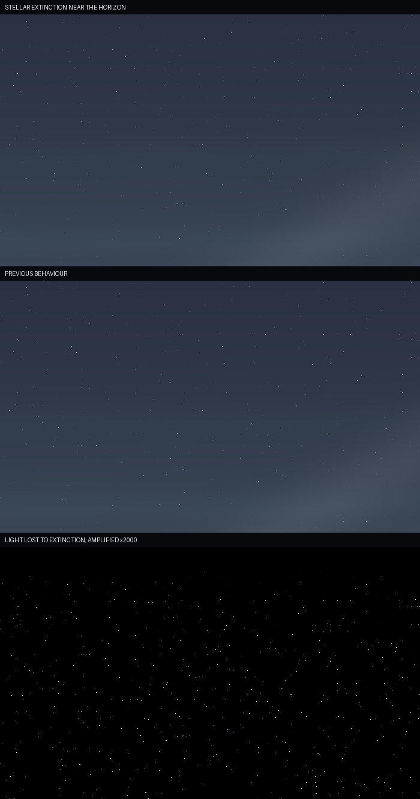

**1.15.57 — low-end optimisation: the whole daytime scattering model is skipped at night (2026-11-04):** The daytime sky colour comes from one scattering block: two vector exponentials, four powers and a fixed horizon tint. Once the sun drops more than about six degrees below the horizon the day factor is exactly zero and that whole result is multiplied away, yet the shader still evaluated it for every sky pixel. The pass now skips the block when the factor is zero; the stars, moon, Milky Way, airglow and the entire night sky are unchanged pixel for pixel, while sunrise, dusk and noon still run it. In the synthetic GPU fixture the block is skipped for 100% of sky pixels at sun elevations of -30 and -10 degrees, still evaluated at -5, 0 and 35 degrees, and all five skies match the previous build exactly (difference 0). No option, texture, lookup or render target is added; night is half of every play session, so this is the most direct saving yet.

**1.15.56 — earthshine follows the moon phase (2026-11-04):** Around new moon the Earth hangs nearly full in the lunar sky and bounces sunlight onto the Moon's far side, so the unlit part of a thin crescent shows a faint grey-blue glow: earthshine, the "old moon in the new moon's arms". The fill used to be a fixed, rather dim constant. It now follows the phase: the smaller the sunlit fraction and the fuller the Earth in the lunar sky, the stronger the fill. Quarter moons keep the previous strength, and at full phase almost no night side is visible so the change hides behind the disk. The fill is also brighter overall, about 2.7% of the sunlit surface, and still stays inside the disk; the halo, the stars and every other direction are unchanged pixel for pixel. In the synthetic GPU fixture the quarter-moon phase factor is exactly one and matches the fixed-coefficient build pixel for pixel, a thin crescent's night side is clearly brighter, and a full moon barely moves. No option, texture or render target is added. The image below is a synthetic GPU comparison of a thin crescent, new behaviour above and the previous build below, brightened for review with the sunlit limb clipping in both panels; it is not a gameplay capture.

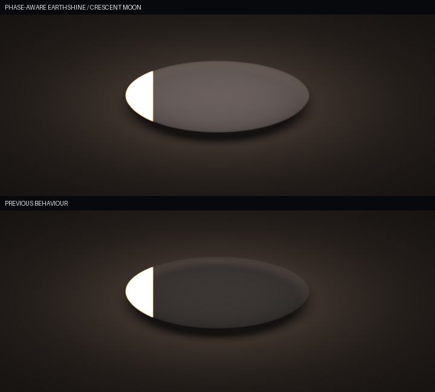

**1.15.55 — low-end optimisation: the eclipse glow only runs during an eclipse (2026-11-04):** The warm eclipse aurora and its corona exist for a short window on one calendar day; for the rest of the year the factor is exactly zero, yet the shader evaluated an exponential and entered the corona function for every sky pixel. The pass now tests the eclipse factor it already computes and skips the block entirely when it is zero. The eclipse-day glow and corona are unchanged pixel for pixel. In the synthetic GPU fixture every ordinary-day sky pixel skips the exponential, every eclipse-day pixel still evaluates it, and both images match the previous build exactly. No option, texture or render target is added, and the saving lands on every sky pixel regardless of clouds or weather.

**1.15.54 — reddening of a low moon (2026-11-04):** Near the horizon moonlight crosses a far thicker column of air than at the zenith, so scattering strips out the blue and both the disk and its halo turn orange like a setting sun. The moon used to stay cold white, with only refraction flattening it. The disk, earthshine and halo now share one extinction tint driven by the moon's elevation: warm orange near the horizon, fading back to white by about 20 degrees. The change only touches the sky within about 25 degrees of the moon, and no option, texture or render target is added. The image below is a synthetic GPU comparison at a 3-degree moon, with the new behaviour above and the previous build below; it is not a gameplay capture.

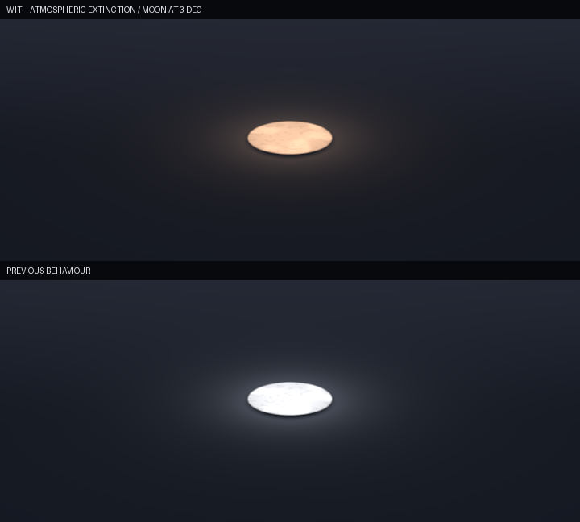

**1.15.53 — low-end optimisation: the sky away from the sun skips the aureole exponentials (2026-11-04):** The compact glow around the sun is built from two Gaussian exponentials; the widest one has decayed past renderable precision by about 37 degrees from the disk and contributes zero. The shader nevertheless evaluated both vector exponentials for every sky pixel. It now tests the angular distance it already has and skips the window entirely. The aureole near the sun, the sky colour, the sun and moon disks and the star field are unchanged pixel for pixel. In the synthetic GPU fixture, a 5, 20, 45, 70 and 89-degree sun skips about 87, 80, 78, 85 and 89 percent of sky pixels respectively, and all five images match the previous build exactly. No option, texture or render target is added, and every player who looks up benefits at any resolution.

**1.15.52 — alpenglow on the cloud deck (2026-11-04):** After the sun drops below the horizon the ground is already dark, but the cloud base can still be lit from below, so a high deck keeps a rose glow through twilight. The cloud march previously shaded only from the direct beam and ambient scatter, and the whole deck turned grey soon after sunset. A warm term now runs while the sun sits between about 1 and 17 degrees below the horizon: it leans orange-red and grows toward the sun, and it strengthens with cloud height. Above or deeper below that window the term is exactly zero and the image matches the previous build pixel for pixel. Overcast suppresses it. In the synthetic GPU fixture noon and deep night are identical to the previous build, twilight clouds are brighter overall with a red increment larger than the blue, and the sunward side gains more than the anti-solar side. No option, texture or render target is added.

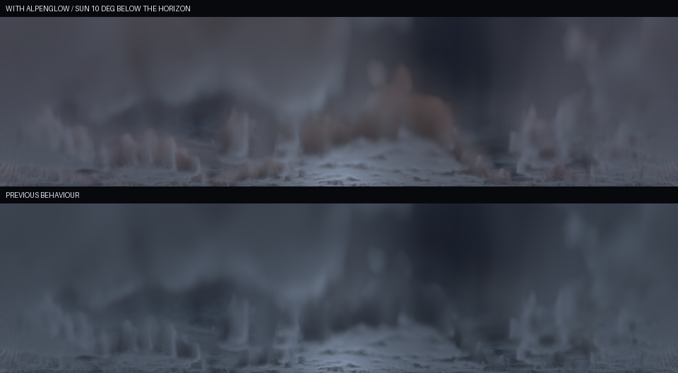

**1.15.51 — low-end optimisation: dry and cave surfaces skip the puddle noise (2026-11-04):** Terrain puddles and their roughness shift only exist on wet ground; the wetness factor is exactly zero in dry weather, in caves and interiors, and on downward-facing faces, yet the shader still evaluated a 2D noise and two mixes for every surface pixel and then multiplied the result away. The block is now skipped when wetness is zero; wet daytime ground, rain and upward faces keep their puddles, and the image is unchanged pixel for pixel. The synthetic GPU fixture skips all puddle-noise calls in the dry-clear, cave-lit and downward-face cases. No option, texture or render target is added, and the saving lands on players who spend their time underground or indoors.

**1.15.50 — the anthelion (2026-11-04):** The parhelic circle is a white horizontal band at the sun's own height; it now carries a faint white spot on the exact opposite side of the sky at the same height, about 20 degrees across. This is the anthelion of the real sky, and it shares the band with the sun-side patch and the 120-degree parhelia. It reuses the existing azimuth cosine, so it adds no trigonometry, texture or render target, and the sunward sky is unchanged pixel for pixel. The image below is a synthetic GPU panorama at a 22-degree sun centred on the anti-solar point, brightened 6x for preview, not a gameplay capture.

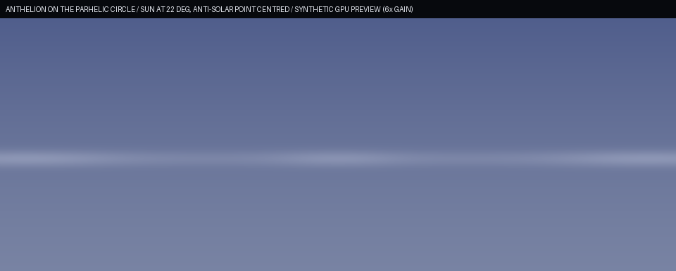

**1.15.49 — low-end optimisation: the parhelic band exits on a height bound (2026-11-04):** The parhelic circle is a white horizontal band at the sun's own height, only about half a degree tall; more than about 8.6 degrees away its exponential underflows to float zero, yet the shader evaluated that exponential for every sky pixel. A height test now skips the call outside the band window, leaving the band, the bright patch near the sun and the 120-degree parhelia unchanged pixel for pixel. The synthetic GPU fixture skips about 85, 78, 73, 53 and 68 percent of the calls at 5, 20, 40, 60 and 89 degrees of solar elevation. No option, texture or render target is added.

**1.15.48 — low-end optimisation: high moon skips the lunar companions (2026-11-04):** Moon dogs and the lunar pillar only exist below about 24 degrees of lunar elevation, and both gates clamp to exactly zero above that, yet every sky pixel inside the halo cap still built the moon basis and evaluated an `atan` and two vertical profiles for light that was multiplied away. Both gates are now computed first and the whole block is skipped when they are zero; moon dogs, the lunar pillar and the lunar tangent arc keep their low-moon behaviour, and the solar branch is untouched. The synthetic GPU fixture counts `atan` calls inside the 37-degree cap: at 3, 10 and 20 degrees the count is unchanged, while 24, 30, 50 and 70 degrees drop from one azimuth trig call per cap pixel to none, with the image unchanged pixel for pixel. No option, texture or render target is added.

**1.15.47 — low-end optimisation: high sun skips the halo dogs and pillar (2026-11-04):** Sun dogs only exist below about 25 degrees of solar elevation, and the sun pillar's gate clamps to exactly zero above about 20 degrees, yet every sky pixel inside the halo cap still evaluated two azimuth `atan` pairs, two `exp` calls and the full vertical profile for light patches that were multiplied away. Both blocks now return early when their gate is zero, and the light's elevation `asin` is hoisted to the top of the branch so the dogs and both tangent arcs share it. The synthetic GPU fixture counts `atan` calls inside the 37-degree cap: dogs still run at 5, 10 and 20 degrees, while 30, 50 and 70 degrees drop from three azimuth trig calls per pixel to one (about 67 percent skipped), with the image unchanged pixel for pixel. No option, texture or render target is added.

**1.15.46 — low-end optimisation: twilight optics exit on their gates (2026-11-04):** The Belt of Venus, the zodiacal light cone and the airglow layer only exist in narrow solar-height windows: above or below them their smooth gate clamps to exactly zero, yet the shader still finished the normalise, `acos`, `exp` and two noise lookups before multiplying the result away. Each body now returns immediately when its gate is zero, and a fully overcast sky skips the whole group. The synthetic GPU fixture skips all three bodies at noon, about 82 percent at a 2° sun, the belt and the cone at deep night (airglow still runs) and 100 percent under full overcast, with the image unchanged pixel for pixel. No option, texture or render target is added.

**1.15.45 — low-end optimisation: azimuth reject before the circumzenithal and Parry arcs (2026-11-03):** Both arcs only exist within a cone around the sun's azimuth: the circumzenithal arc has faded out beyond 60°, and the Parry arc is exactly zero beyond 30°. Previously every sky pixel ran an `acos` just to discover that. A single azimuth dot product now rejects the cone, so pixels outside it skip the arccosine and all the exponential and tint work that followed. The synthetic GPU fixture skips about 63, 72 and 78 percent of those calls at 5°, 20° and 30° solar elevation, with the image unchanged pixel for pixel; at 70° neither arc is active, so the count is unchanged. No option, texture or render target is added.

**1.15.44 — low-end optimisation: dot-product reject before the 46° ring (2026-11-03):** The 46° ring is a narrow 0.02-radian Gaussian and contributes nothing more than nine degrees away from it, yet the shader evaluated an `acos` and an `exp` for every sky pixel. A single dot product now tests whether the ray is near the ring, and only pixels inside that annulus run the trigonometry and the exponential. The synthetic GPU fixture skips about 90, 87, 74 and 78 percent of those calls at 5°, 20°, 40° and 70° solar elevation, with the image unchanged pixel for pixel. No option, texture or render target is added; the saving lands on the daytime sky path.

**1.15.43 — low-sun parhelia stretch into a short pillar (2026-11-03):** Once the sun sits below about 10°, a sun dog is no longer just a small upright patch: it lengthens into a short pillar as the sun nears the horizon, while its horizontal width and its red inner / pale-blue outer tint stay the same. This is the same plate-crystal family as the sun pillar: a longer vertical scattering path at grazing solar angles. The change only alters one vertical Gaussian radius and adds no sample, texture or render target; above about 11.5° the original 2.5° radius returns. It shares the `ICE_HALOS` toggle with the ring, pillar and tangent arcs, adding no option. The image below is a synthetic GPU close-up of the right-hand dog at a 3° sun, brightened for preview, not a gameplay capture.

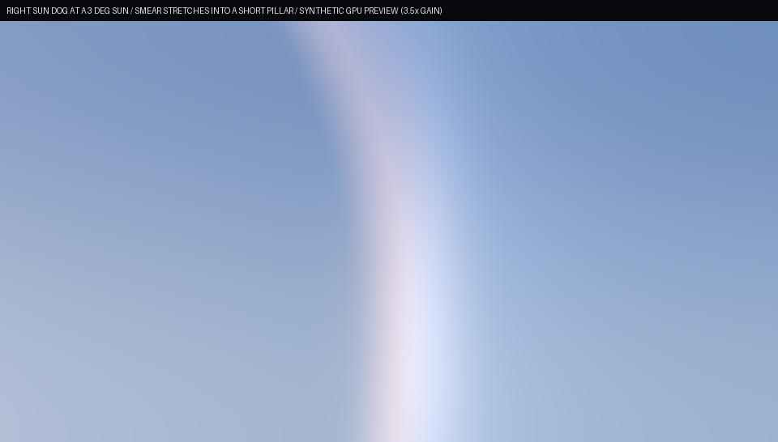

**1.15.42 — low-end optimisation: one fewer noise and atmosphere sample in the cloud march (2026-11-03):** The volumetric march evaluates an edge-erosion noise at every sample, but a sample whose density already clamped to zero stays zero no matter how much is eroded. Empty samples now skip that call: the synthetic GPU fixture measures about 67, 57 and 21 percent fewer erosion-noise calls in clear, overcast and rain, with the cloud image unchanged pixel for pixel. The aerial-perspective sample in the same pass is now deferred until the first sample that actually scatters and cached for the rest of the march, so sky rays that cross the layer without a hit no longer run the full atmosphere; at the lowest cloud coverage about 2 percent of sky pixels save that call. Neither change adds an option, texture, lookup or render target, and both help integrated GPUs and low-end laptops.

**1.15.41 — spectral sun dogs (2026-11-03):** The parhelia beside a low sun are no longer a single flat warm patch; they now split into a small spectrum the way real ice crystals do: the flank facing the sun is red-orange and the far flank fades to pale blue-white, while the smear keeps its upright shape. The split reuses the ray's angular distance from the sun's azimuth, so it adds no trigonometry, texture or render target; moon dogs keep their original cool white. It shares the `ICE_HALOS` toggle with the 22° ring, pillar and both tangent arcs, adding no option. The image below is a synthetic GPU close-up of the right-hand dog at a 7° sun, brightened for preview, not a gameplay capture.

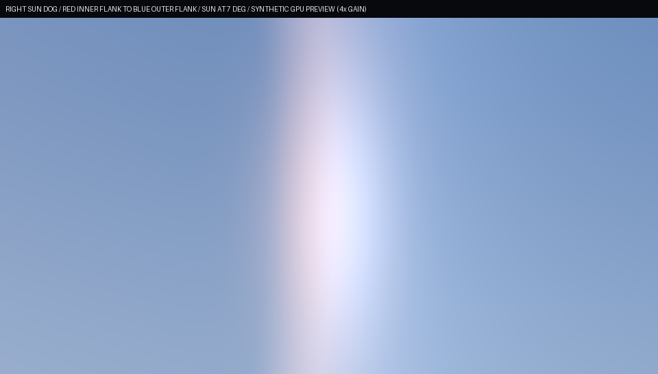

**1.15.40 — lower tangent arc (2026-11-03):** Once the sun climbs above roughly 32°, a bright band tangent to the bottom of the 22° halo appears: strongest straight below the sun and fading to the sides, the mirror image of the upper tangent cap. It retires below that solar height and reuses the existing clear-ice visibility gate. It shares the `ICE_HALOS` toggle with the ring, sun dogs, pillar and upper tangent arc, adding no option; it is an analytic azimuth envelope and height window, adding no texture, lookup table or render target. The image below is a synthetic GPU upper-sky panorama with the arc brightened for preview, not a gameplay capture.

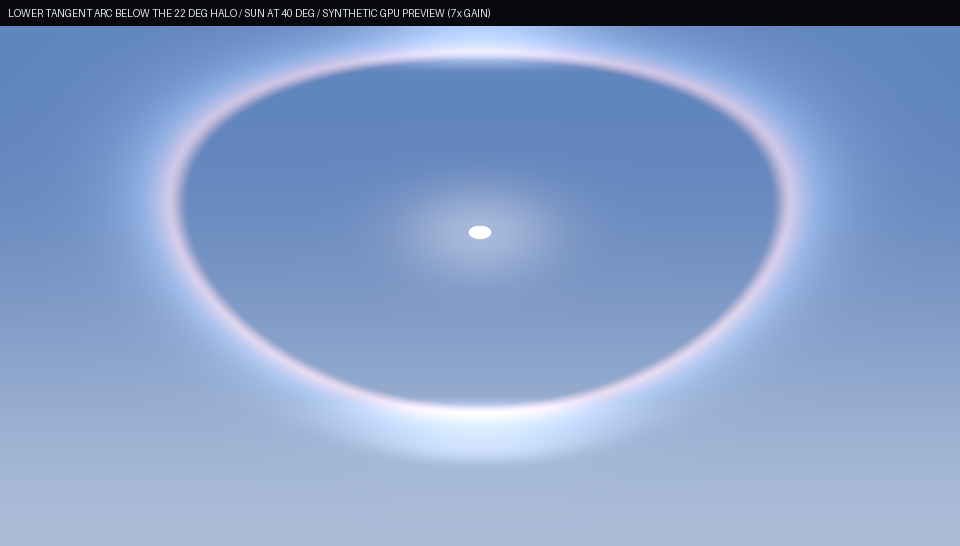

**1.15.39 — low-end optimisation: skip the sky sample in cave and indoor fog (2026-11-03):** Terrain fog samples the sky once to colour distant haze. In a cave, an interior or anywhere the sky light is zero the outdoor weight is exactly zero, so that sample is multiplied away, yet the shader still evaluated the full atmosphere, sun/moon halos and night-sky layers. Those pixels now skip the sky sample and keep their original cave fog colour; outdoor pixels at day, dusk and night and the sky-flag path are pixel-for-pixel unchanged. No option is added and no visible effect is removed; players who spend their time underground or indoors on low-end hardware gain the most.

**1.15.38 — upper Parry arc (2026-11-03):** When the sun stands roughly 13°–32° high, a faint arc rides just above the top of the 22° halo: it peaks about 25° above the sun's centre, runs about 25° sideways and then sags back down toward the ring, giving the shallow V or "sun cave" shape of a Parry arc. The band is mostly white with a faint red-orange underside and a pale violet upper edge. It needs vertically aligned plate crystals, so it is rarer and fainter than the tangent arc. It joins the existing `ICE_HALO_COMPANIONS` toggle without adding an option and reuses the clear-ice visibility gate, retiring automatically when the sun is too low or too high. It is an analytic azimuth envelope, a parabolic height and a vertical Gaussian band, adding no texture, lookup table or render target. The image below is a synthetic GPU upper-sky panorama with the arc brightened for preview, not a gameplay capture.

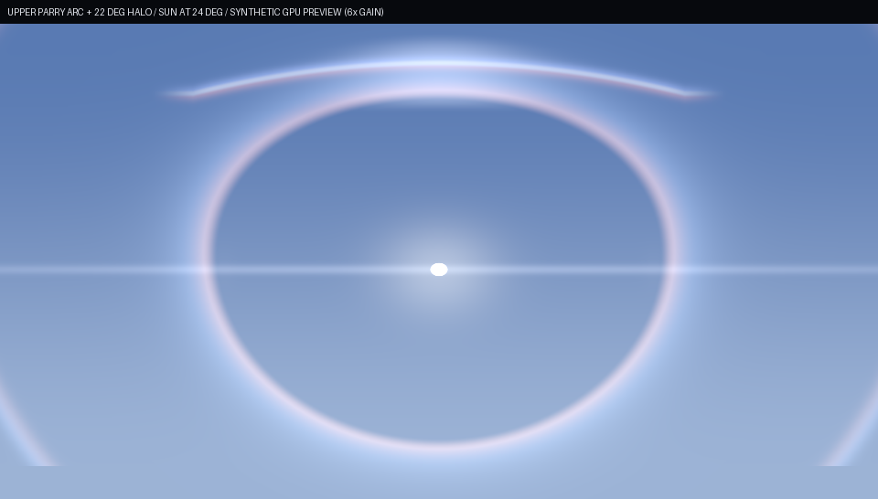

**1.15.37 — low-end optimisation: skip the cirrus noise under full overcast (2026-11-03):** The high cirrus veil is scaled by (1 - overcast), which is exactly zero under a full deck, but the shader still evaluated a warp noise, a 2–4 octave fbm and a sine streak. At 99.9% overcast the layer now returns the incoming sky before that noise, so rain and storm skies stop paying for cirrus nobody can see; clear and thin-cloud weather keep the layer pixel-for-pixel. No option is added and no visible effect is removed.

**1.15.36 — low-end optimisation: five-tap TAA history clamp at quality 1 (2026-11-03):** At TAA quality 1 the history clamp now reads the centre and four edge neighbours instead of the full 3×3 box, saving four texture fetches per resolved pixel. The diagonals are the taps least likely to catch a moving edge, so the low profile gives up only a little clamp margin on diagonal motion; qualities 2 and 3 keep the original 3×3 box pixel-for-pixel. No option is added and the visible effect range is unchanged.

**1.15.35 — low-end optimisation: skip every bloom pass at zero strength (2026-11-03):** With bloom strength at 0, the shader still ran the sixteen-tap bright pass, both five-tap Gaussian blurs and a final bloom fetch, then multiplied the result by zero. All three bloom passes now output zero and skip 27 texture fetches at strength 0; the strength-1.0 image stays pixel-identical. No option is added and no visible effect is removed: turning bloom off now actually saves the whole post chain on low-end machines.

**1.15.34 — low-end optimisation: skip volumetrics at zero god-ray strength (2026-11-03):** With the god-ray slider at 0, the shader still ran the 8–40-step shadowed volumetric integral for every pixel and multiplied the result by zero. The shaft integral is now skipped entirely at strength 0, keeping only the independent lightning flash; the underwater shaft path returns early too. The default strength of 1.0 stays pixel-identical, and storm flashes still appear at 0. No new option is added; low-end players who turn god rays off now actually save the volume steps.

**1.15.33 — low-end optimisation: daytime star-field early-out (2026-11-03):** The star layer is scaled by remaining night times clear sky, which is exactly zero at noon and under full overcast, but every pixel still computed the star cell hash, the scintillation sines and two colour hashes. The whole star block is now skipped below 0.2%, removing that work from the daytime sky path. Stars, twinkle and colour remain pixel-identical at night and twilight. The optimisation adds no option and removes no visible effect: the noon image matches both the pre-change code and a star-free variant exactly, while night stars stay visible.

**1.15.32 — low-end optimisation: daytime cosmic sky early-out (2026-11-03):** Once the sun is up, the night-sky layers (galaxy, aurora, meteors, comet and supernova) are multiplied to zero by the daylight term, but the shader still evaluated all of their noise first. The whole block is now skipped whenever that term falls below 0.2% (sunrise, or thick enough cloud), so noon and overcast skies no longer pay for stars nobody can see. Twilight, night and sunset remain pixel-identical. The optimisation adds no option and removes no visible effect: in synthetic GPU comparisons the noon image matches both a cosmic-free sky and the pre-change code exactly.

**1.15.31 — atmospheric refraction (2026-11-02):** A sun or full moon near the horizon is no longer a perfect circle: the whole disk is lifted by atmospheric refraction while its vertical diameter narrows, and the lower limb rises more than the upper one, so a low sun reads as a slightly flattened oval. The difference is noticeable only below roughly 17° and disappears as the body climbs higher; the green rim of the sunset flash now follows the flattened upper limb as well. A new Atmosphere → Atmospheric refraction toggle (on by default) restores the round disks when off. An analytic refraction-lift function adds no texture, lookup table or render target. The image below compares synthetic GPU sun and moon disks with the option off on the left and on the right; it is not a gameplay capture.

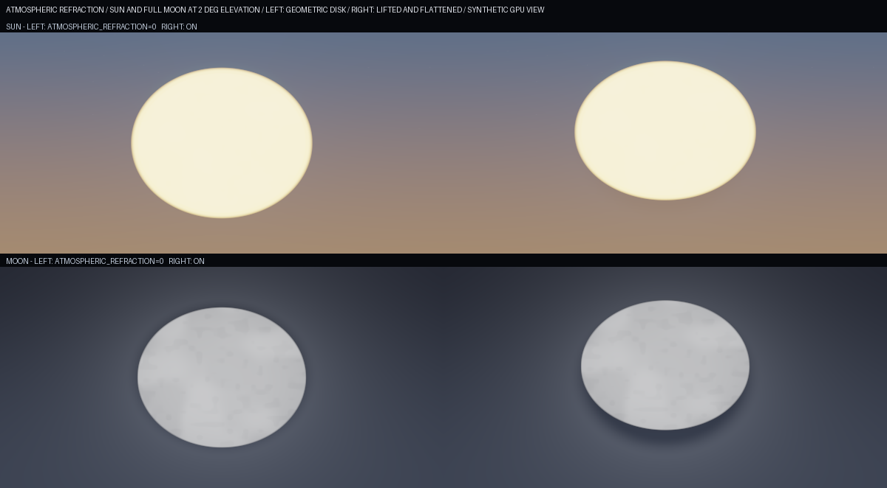

**1.15.30 — Bishop's ring (2026-11-02):** Under a clear, lightly dusty daytime sky a very broad, very faint dust aureole surrounds the sun: about 24° in radius, warm brown-pink on its inner edge and fading outward to a cool pale blue, with an edge so soft it almost merges into the sky. It is far wider than the 22° ice-crystal halo and never brings parhelia or tangent arcs. It leaves when the sun sits near the horizon, at night or under overcast. A new Atmosphere → Bishop's ring toggle (on by default) controls it. An analytic wide Gaussian with a warm-to-cool tint adds no texture, lookup table or render target. The image below is a synthetic GPU solar view with the ring brightened for review; it is not a gameplay capture.

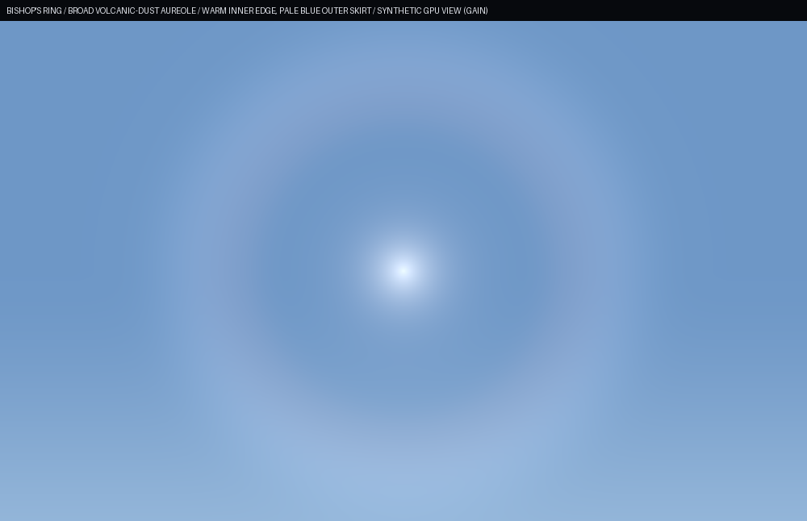

**1.15.29 — thin-cloud iridescence (2026-11-02):** Soft pastel fringes now appear in high thin cloud near the sun: tiny uniform droplets diffract sunlight into blue, green, pink and orange arcs that tighten toward the disk and fade by roughly 30°. The fringes show only inside broken thin-cloud patches, never as complete concentric rings on a clear sky, and they leave under thick cloud, overcast or a sun near the horizon. A new Clouds → Cloud iridescence toggle (on by default) controls it. An analytic broken-veil mask and angle cosine add no texture, lookup table or render target. The image below is a synthetic GPU sky patch near the sun with the fringes brightened for review; it is not a gameplay capture.

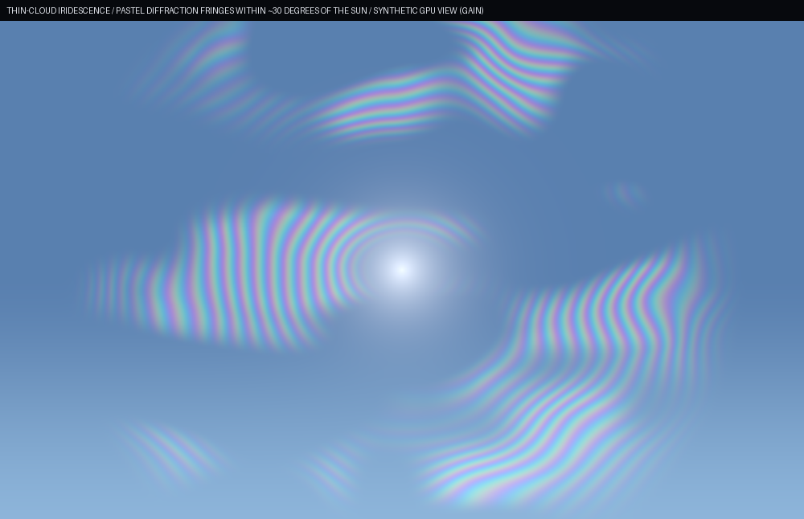

**1.15.28 — aurora curtain folds (2026-11-02):** The auroral curtain no longer hangs as one flat ribbon: it bends into several large hanging pleats that carry its green lower band and violet upper band up and down together, while the fine rays bunch and brighten where a fold gathers and dim where it opens. The folds touch only the existing curtain, leaving its strength, visibility conditions and zenith corona unchanged; daylight, overcast and the southern sky still exit as before. A new Cosmic Sky → Aurora curtain folds toggle (on by default) restores the flatter ribbon when off. Analytic low-frequency displacement and phase modulation add no texture, lookup table or render target. The image below compares the same synthetic GPU northern aurora with the option off on the left and on the right, brightened for review; it is not a gameplay capture.

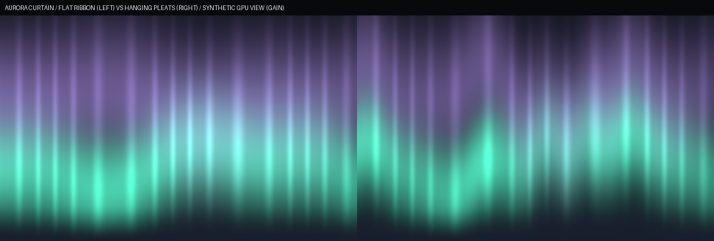

**1.15.27 — noctilucent wave trains (2026-11-02):** The noctilucent sheet is no longer one smooth blue-white veil: two crossed gravity-wave trains cut through it, their crests bending along the cloud wisps, stretching in perspective near the horizon and drifting slowly over time. The ripples modulate only the brightness of the existing layer, leaving its coverage, colour and visibility window unchanged; daylight, deep night and overcast still exit through the old gates. A new Clouds → NLC wave trains toggle (on by default) restores the smoother veil when off. Two analytic phase cosines riding the existing noise warp add no texture, lookup table or render target. The image below compares the same synthetic GPU noctilucent cloud with the option off on the left and on the right, with the layer brightened for review; it is not a gameplay capture.

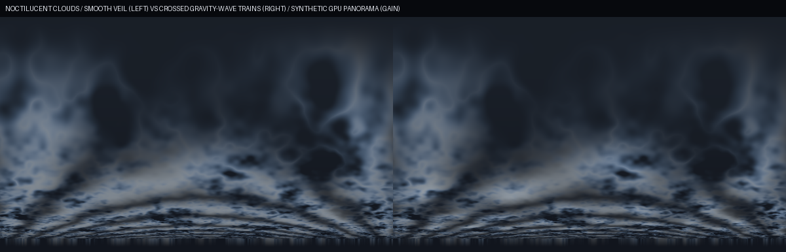

**1.15.26 — airglow gravity-wave ripples (2026-11-02):** The night airglow is no longer one smooth green-teal veil: a set of faint horizontal bands now sits around 10° elevation, stacked like upper-atmosphere gravity waves, bending slowly across azimuth and drifting as a whole. The ripples modulate only the existing night airglow, so daylight, twilight and overcast keep their old gates, and the Belt of Venus, zodiacal light and star field are untouched. A new Atmosphere → Airglow ripples toggle (on by default) restores the previous smooth glow when off. A folded cosine with an azimuth warp is analytic and adds no texture, lookup table or render target. The image below is a synthetic GPU panorama with the airglow brightened for review, not a gameplay capture.

**1.15.25 — star colour (2026-11-02):** The star field is no longer one uniform white. Each star now takes a stable surface-temperature tint from its own hash, running from warm orange through pale yellow and near-white to cool blue-white, plus an independent brightness spread so faint stars are more numerous and bright ones stand out. The colour touches only the existing stars and twinkle, never the galaxy, aurora or meteors. A new Atmosphere → Star colour toggle (on by default) restores the previous uniform white field when switched off. Two hashes and one tint interpolation per star add no texture, lookup table or render target. The image below is a synthetic GPU star field with the stars enlarged for review, not a gameplay capture.

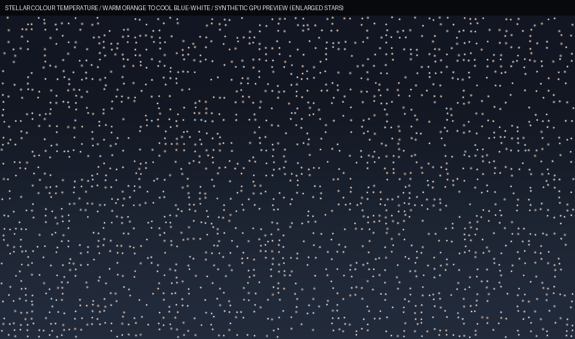

**1.15.24 — total-eclipse corona and prominences (2026-11-02):** Once the Moon fully hides the solar photosphere, a pale corona opens around the black disk: curved streamers radiate outward, the belt is broader near the solar equator and narrows into fine plumes over the poles, while a few red prominences sit on the limb and shift slowly. It appears only around totality inside the existing eclipse window, is suppressed under overcast and leaves as soon as the eclipse ends. It shares the `CELESTIAL_EVENTS` schedule, with no new option. Analytic polar streamers, radial falloff and a limb-red Gaussian add no texture, lookup table or render target. The image below is a synthetic GPU eclipse close-up with the corona brightened for preview, not a gameplay capture.

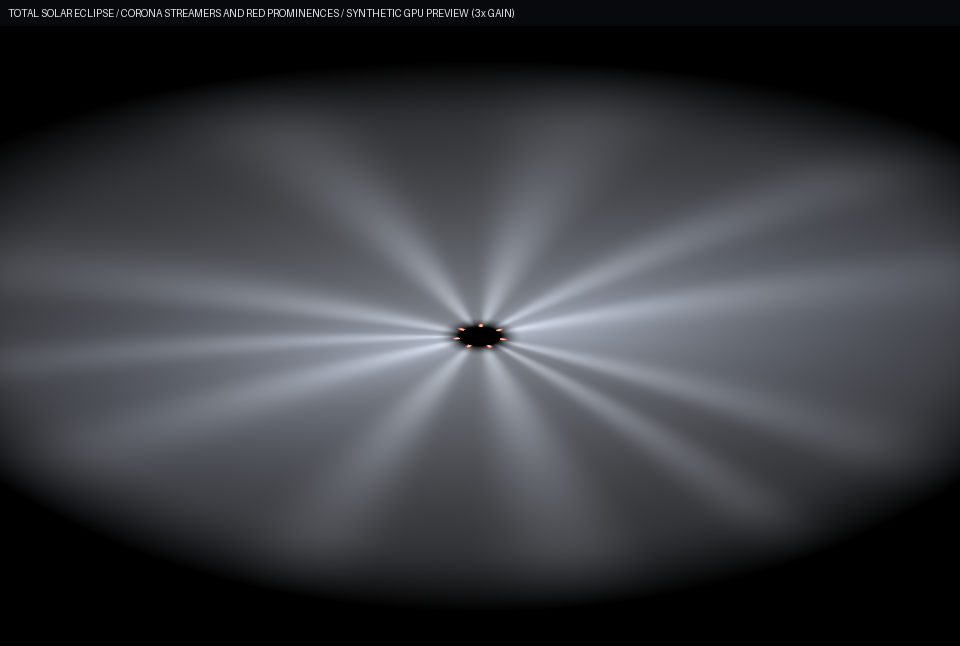

**1.15.23 — meteor persistent train (2026-11-02):** After a bright meteor passes, its path does not snap back to darkness. A faint green afterglow lingers for a few seconds, wider and dimmer than the meteor itself, broken into slowly drifting knots, brightest around the middle and fading at both ends. It appears only during meteor events on a clear night, peaks after the meteor head has gone and then fades naturally. It shares `COSMIC_SKY_QUALITY`, `CELESTIAL_EVENTS` and the night/cloud gates, with no new option. An analytic path-plane Gaussian with two knot frequencies adds no texture, lookup table or render target. The image below is a synthetic GPU night view with the train brightened for preview, not a gameplay capture.

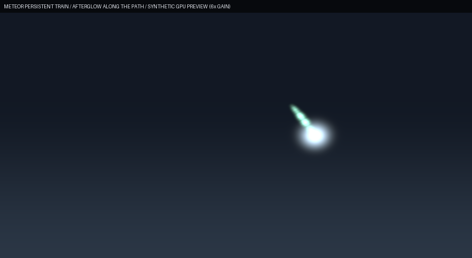

**1.15.22 — moon dogs and lunar tangent arc (2026-11-02):** When a low, bright moon lights high plate ice crystals, the 22° lunar halo now gains a cool, vertically stretched moon dog on each side and a pale cap tangent to its top. Both appear only while the moon is below about 23°, stay near half the brightness of the equivalent solar parhelia and are visibly cooler; they fade as the moon climbs. They share the `ICE_HALOS` toggle, with no new option. Analytic azimuth/elevation Gaussians and a tangent-arc envelope add no texture, lookup table or render target. The image below is a synthetic GPU night panorama with the ice-halo brightness raised for preview, not a gameplay capture.

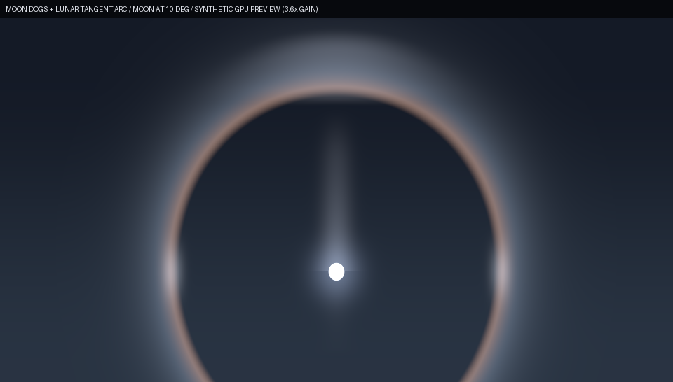

**1.15.21 — comet anti-tail (2026-11-02):** While the comet is active, a very thin dust needle now points sunward beside the ordinary anti-sunward dust tail—larger grains spread along the orbital plane and read as a spike from near that plane. It is far narrower than the dust tail, brightest near the head, fades quickly with distance and does not appear behind the head. It shares the existing `CELESTIAL_EVENTS` schedule and the night/clear-sky gates, with no new option; an analytic tangent-plane Gaussian spike with a monotonic falloff adds no texture, lookup table or render target. The image below is a synthetic GPU comet view with the anti-tail brightened for preview, not a gameplay capture.

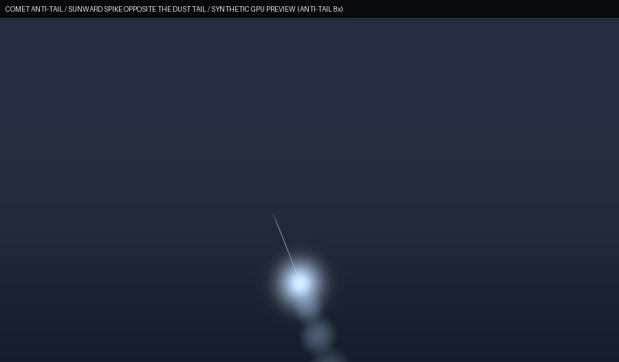

**1.15.20 — auroral zenith corona (2026-11-02):** When the aurora is active, looking straight up now gathers the curtain into a corona of rays converging on the zenith: green toward the centre and shifting violet toward the fringe, rising and falling slowly with aurora strength and time. It shares `COSMIC_SKY_QUALITY`, `COSMIC_SKY_STRENGTH` and the existing cold-biome/storm gates, with no new option. It is a folded analytic azimuth pattern inside a soft zenith cap, adding no texture, lookup table or render target. The image below is a synthetic GPU fisheye view of the zenith with the corona brightened for preview, not a gameplay capture.

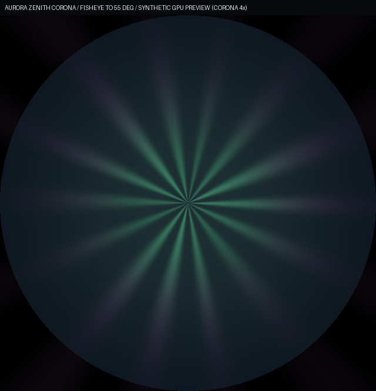

**1.15.19 — fog bow (2026-11-02):** Once rain has stopped but the air is still wet and cloudy, tiny fog droplets smear the refraction bow into a broad, almost white 42° anti-solar arc, leaving only a faint cool inner rim and warm outer rim. The sun must be behind the viewer and below about 42°, and the fog bow takes over from the coloured rain bow rather than sharing an active downpour. A new `FOGBOW` toggle (on by default, Weather page) controls it. It is an analytic radial band with a slight tint shift, adding no texture, lookup table or render target. The image below is a synthetic GPU fog panorama with the bow brightened for preview, not a gameplay capture.

**1.15.18 — stellar scintillation (2026-11-02):** Stars no longer hold a constant brightness: turbulence in the lower atmosphere makes each one flicker quickly on its own phase and rate, and the swing grows near the horizon where the line of sight crosses more air. The effect is clearest late at night under a clear sky; cloud and moonlight still dim the field. A new `STAR_SCINTILLATION` slider (default 1.0, Atmosphere page) controls it, and 0 holds every star steady. Each star's phase comes from a stable hash, with no texture, lookup table or render target. The image below compares the same synthetic GPU star field at two instants with the twinkle swing raised for preview; it is not a gameplay capture.

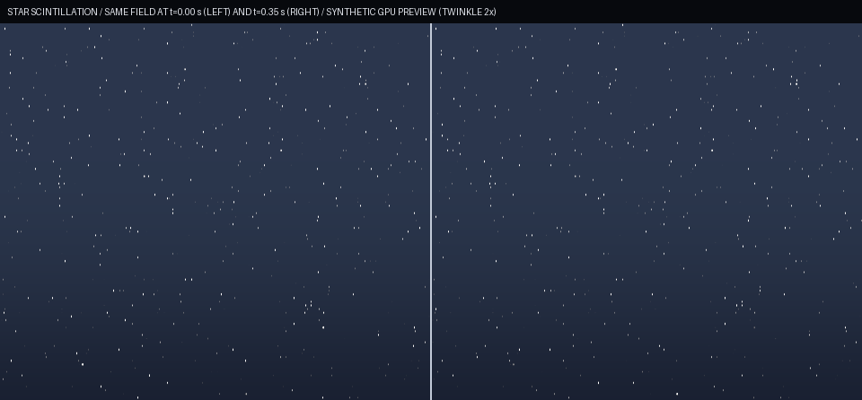

**1.15.17 — circumzenithal arc (2026-11-02):** When the sun sits below about 26°, plate crystals draw a bright coloured smile about 46° above it, its ends sagging toward the horizon and its centre near the zenith; red lines the lower edge and violet the upper, and the arc fades out above roughly 30° of solar elevation. It shares the `ICE_HALO_COMPANIONS` toggle with the 46° ring and circumhorizontal arc, adding no new option, and reuses the existing clear-ice visibility gate. It is an analytic Gaussian band with an azimuth envelope, adding no texture, lookup table or render target. The image below is a synthetic GPU upper-sky panorama with the arc brightened for preview, not a gameplay capture.

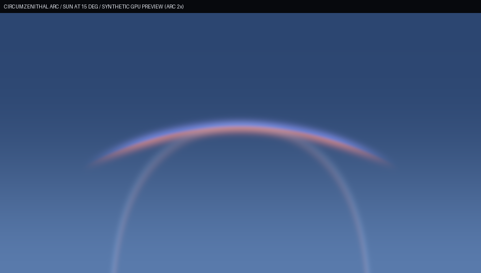

**1.15.16 — lunar corona (2026-11-02):** A compact set of soft diffraction rings now surrounds a bright moon in thin cloud, about 2°–8° in radius, leaning blue-white near the disk and warmer outside. The rings scale with the illuminated moon fraction and night brightness, fade under overcast and are suppressed further in rain. A new `LUNAR_CORONA` toggle (on by default, Atmosphere page) controls them. Unlike ice halos, a corona comes from diffraction by cloud droplets rather than refraction by crystals, so it does not depend on `ICE_HALOS`. It is an analytic radial cosine with a soft envelope, adding no texture, lookup table or render target. The image below is a synthetic GPU night panorama with the ring brightness raised for preview, not a gameplay capture.

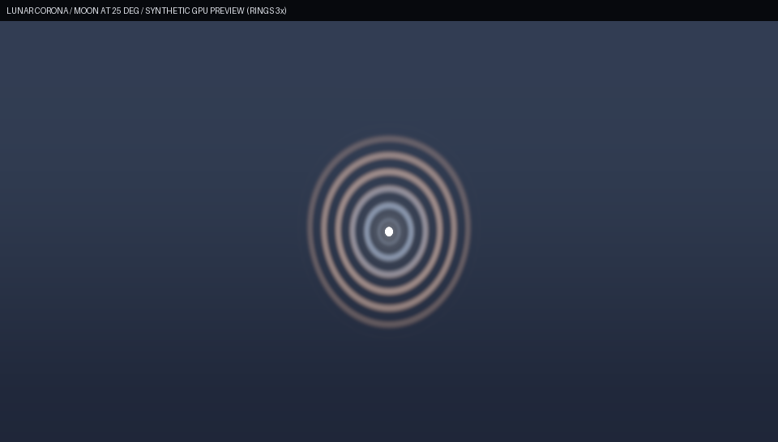

**1.15.15 — supernumerary arcs (2026-11-02):** A few very thin pale green and pink fringes now appear a couple of degrees inside the violet edge of the primary bow—interference between the rays that form it, also called supernumerary arcs. They stay inside the narrow band where the bow is already fading and disappear outside it; rain or wetness, solar elevation and overcast gate them like the primary. They join the existing weather/rainbow system with no new option and are a damped analytic cosine, adding no texture, lookup table or render target. The image below is a synthetic GPU panorama with the fringe brightness raised for preview, not a gameplay capture.

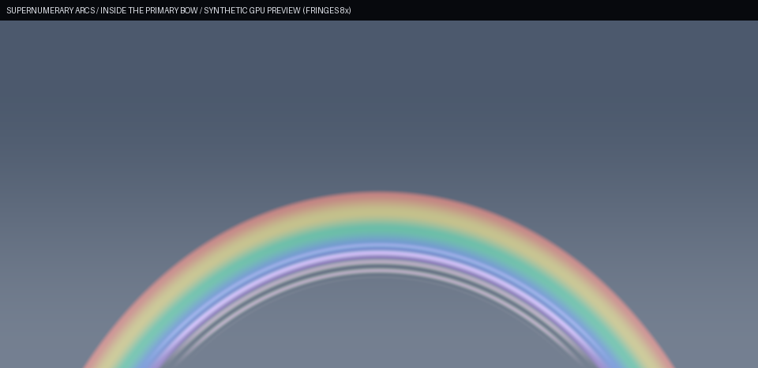

**1.15.14 — secondary rainbow and Alexander's dark band (2026-11-02):** About 9° outside the primary bow, a fainter secondary arc now appears with its colours reversed—red inside and violet outside. The sky between the two bows is slightly darker than on either side, forming Alexander's dark band. The secondary bow appears only during rain or lingering wetness, with the sun above the horizon and the sky not fully overcast; it stays near a tenth of the primary brightness. It joins the existing weather/rainbow system with no new option and is analytic angle work, adding no texture, lookup table or render target. The image below is a synthetic GPU double-rainbow panorama with the secondary bow brightened for preview, not a gameplay capture.

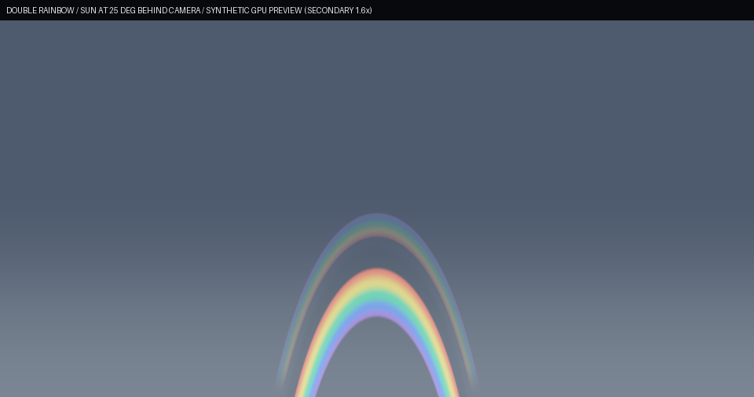

**1.15.13 — lunar pillar (2026-11-02):** A bright low moon also draws a narrow, faint cool shaft from the same plate crystals, rising from the disk with a short reflection below it; the shaft weakens as the moon climbs and disappears above about 20°. It shares the `ICE_HALOS` toggle, with no new option, stays at about half the solar pillar brightness and never adds sun dogs or a tangent arc. Everything is analytic angle work, with no texture, lookup table or render target. The image below is a synthetic GPU night panorama with preview gain, not a gameplay capture.

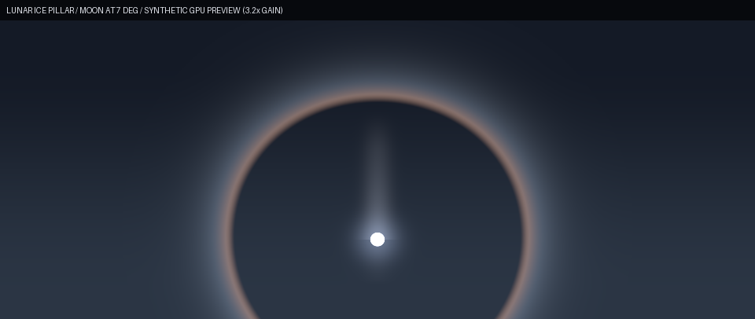

**1.15.12 — parhelic circle (2026-11-02):** A very faint white horizontal band crosses the sky at the sun's own altitude, passing through the sun dogs and continuing all the way around; it is a little brighter beside the sun and near the 120° parhelia. Plate ice crystals produce it, so it shares the clear ice-crystal weather of the 22° halo, 46° halo and circumhorizontal arc and disappears below the horizon. It joins the Atmosphere → 46° halo & arc toggle, with no new option; everything is analytic angle work, with no texture, lookup table or render target. The image below is a synthetic GPU panorama with preview gain, not a gameplay capture.

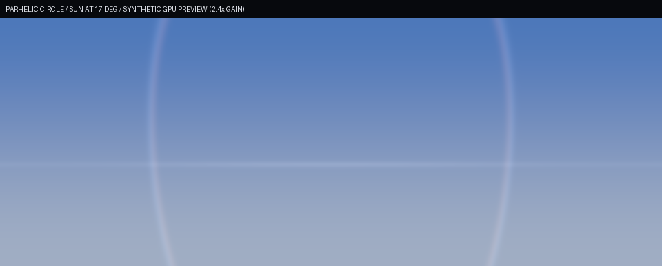

**1.15.11 — 46° halo and circumhorizontal arc (2026-11-02):** Beyond the 22° halo, a wider and fainter 46° ice-crystal ring now shows a red inner edge and a blue outer edge. Once the sun climbs above roughly 58°, horizontally aligned plate crystals instead light the circumhorizontal arc: a spectral band about 46° below the sun, spanning the sky, red on its upper edge and blue-violet below, brightest on either side of the solar azimuth. Both appear only in clear ice-crystal weather and exit early for a low or rainy sun. A new Atmosphere → 46° halo & arc toggle defaults to on. Everything is analytic angle work; no texture, lookup table or render target is added. The image below is a synthetic GPU high-sky panorama with preview gain, not a gameplay capture.

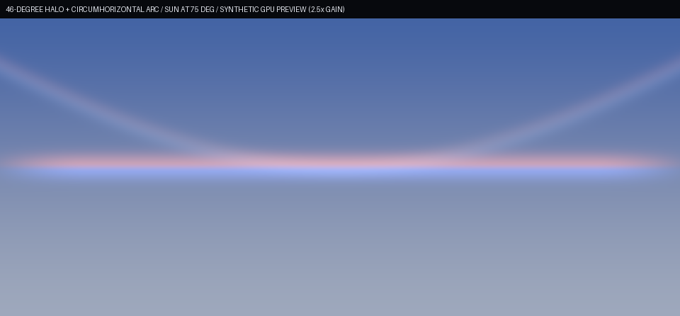

**1.15.10 — anti-solar rays (2026-11-02):** When the sun sits near the horizon, a very faint fan of light and dark spokes converges on the anti-solar point in the opposite half of the sky—cloud shadows seen in perspective. The fan appears only between about −6° and +14° solar height, exits immediately across the sunward half, leaves a dark core at its own focus and fades under overcast. A new Atmosphere → Anti-solar rays toggle defaults to on. Everything is analytic angle work with a little procedural noise; no texture, lookup table or render target is added. The image below is a synthetic GPU anti-solar panorama with preview gain, not a gameplay capture.

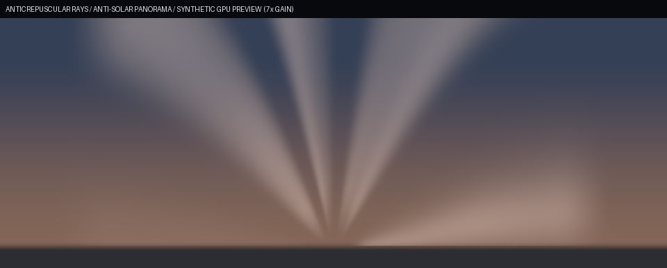

**1.15.9 — green flash (2026-11-02):** In the last degree before sunset or the first after sunrise, a thin green-teal rim appears on the top limb of the sun. It covers only the upper half of the disk and slightly dims the warm disk underneath, so the additive colour is not washed out by the highlight; a high, fully set or cloudy sun produces none. A new Atmosphere → Green flash toggle defaults to on. Everything is analytic angle work; no texture, lookup table or render target is added. The image below is a synthetic GPU solar close-up with preview gain, not a gameplay capture.

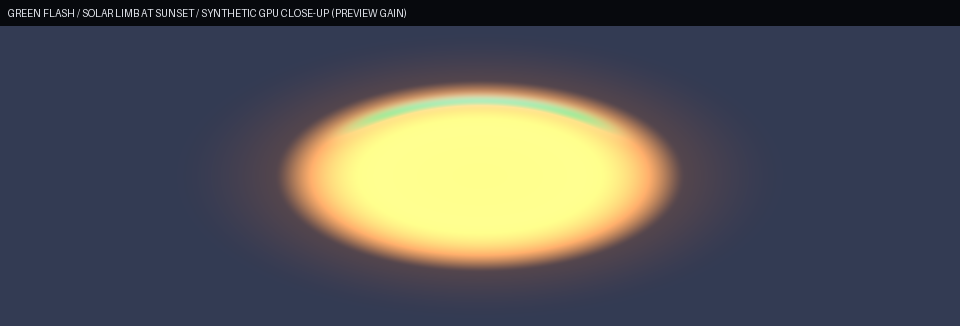

**1.15.8 — nacreous clouds (2026-11-02):** In the winter twilight, soft lenticular sheets appear high in the stratosphere, diffracting into a pastel pink, green and blue nacre. They are most visible near the horizon and fade upward. The layer appears only while the sun is about 2°–13° below the horizon, is much stronger in winter and needs clear weather; it differs from the noctilucent layer in altitude, season and colour. A new Clouds → Nacreous clouds toggle defaults to on. Everything is analytic noise plus three phase-offset cosines; no texture, lookup table or render target is added. The image below is a synthetic GPU panorama with preview gain, not a gameplay capture.

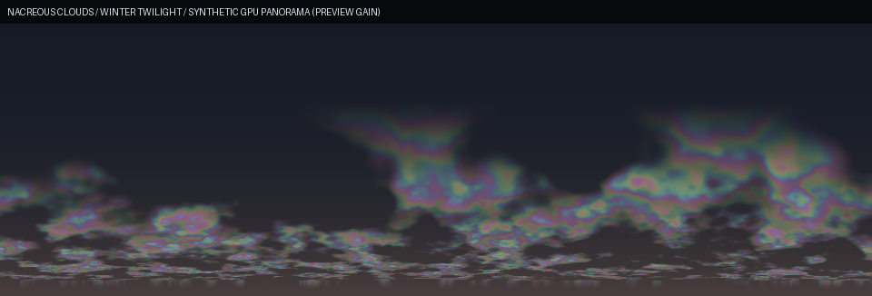

**1.15.7 — zodiacal band and gegenschein (2026-11-02):** After astronomical twilight the zodiacal dust reads as a faint silver band along the ecliptic, with a brighter oval gegenschein around the anti-solar point. The oval is longer along the ecliptic than across it, reads warmer than the band and fades near the horizon. The ecliptic is approximated by the plane through the sun direction and the celestial rotation axis; the outer band is cool and the spot warm. A new Atmosphere → Zodiacal band / gegenschein toggle defaults to on. The layer appears only once the sun is about 7° below the horizon, clouds suppress it and all of it is analytic angle work. The image below is a synthetic night-sky GPU panorama with preview gain, not a gameplay capture.

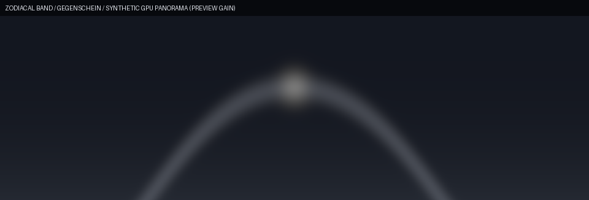

**1.15.6 — moonbow (2026-11-02):** On a rainy night with the moon above the horizon, a faint silver arc appears about 42° from the anti-lunar point. It shares the solar bow's refraction geometry and post-rain moisture, but its colour is almost fully desaturated and cooled, retaining only a trace of spectral order; brightness follows the illuminated moon fraction. A new moon or dry air removes it. A new Weather → Moonbow toggle defaults to on. Everything is analytic angle work; no texture, lookup table or render target is added. The image below is a synthetic rainy-night GPU panorama with preview gain, not a gameplay capture.

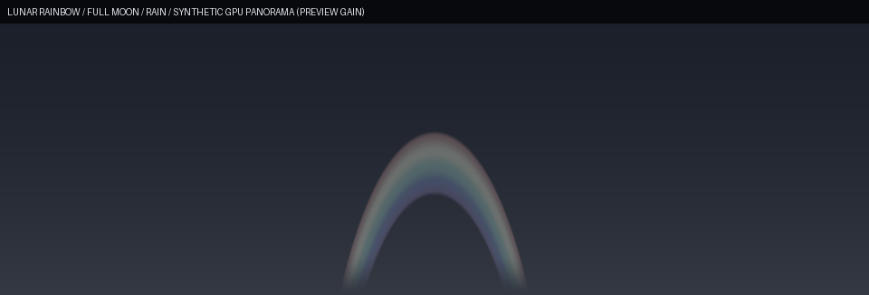

**1.15.5 — ice crystal halos (2026-11-02):** Cirrus ice crystals draw a fine ring about 22° from the sun or moon, red on the inner rim and blue outside. With a low sun, vertically stretched parhelia appear on both sides, an upper tangent arc caps the ring and a pillar rises from the horizon. The moon keeps only the circular ring; it produces no parhelia or pillar. A new Atmosphere → Ice crystal halos toggle defaults to on. Everything is analytic angle work, and sky pixels farther than about 35° from the light exit before any trigonometry; no texture, lookup table or render target is added. The image below is a synthetic GPU panorama with preview gain, not a gameplay capture.

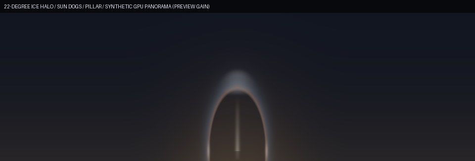

**1.15.4 — noctilucent clouds (2026-11-02):** After sunset, when the lower sky is dark but the mesosphere is still sunlit, blue-white high cloud bands with slow wave structure appear above the horizon. The layer is projected onto a horizontal plane, so it stretches in perspective and fades toward the zenith. It is strongest in summer and appears only in the roughly -3° to -26° solar window, in clear weather and at low elevation, correctly veiling stars and the Milky Way. A new Clouds → Noctilucent clouds toggle defaults to on. Everything is analytic noise; no texture, lookup table or render target is added. The image below is a synthetic GPU panorama with preview gain, not a gameplay capture.

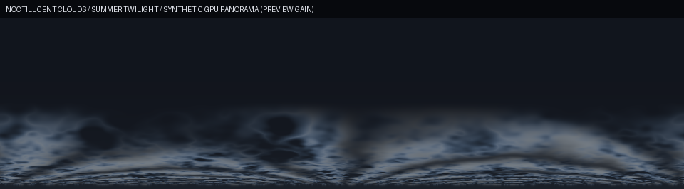

**1.15.3 — twilight optics (2026-11-02):** Adds the anti-solar Earth's shadow and Belt of Venus, a sunward zodiacal-light cone and night airglow. Just after sunset the anti-solar horizon first darkens under a cool blue-grey shadow wedge, capped by a narrow pink-violet belt; the zodiacal light then opens as a silver-yellow cone above the sun's set point, widening and fading with elevation; after full darkness a slow green-teal airglow layer appears around 10° elevation. All three share one Atmosphere → Twilight optics strength slider (default 1), and cloud or storm cover suppresses them. Everything is evaluated analytically from angles and procedural noise, with no texture, lookup table or render target. The image below is a synthetic GPU panorama with preview gain applied; it is not a gameplay capture.

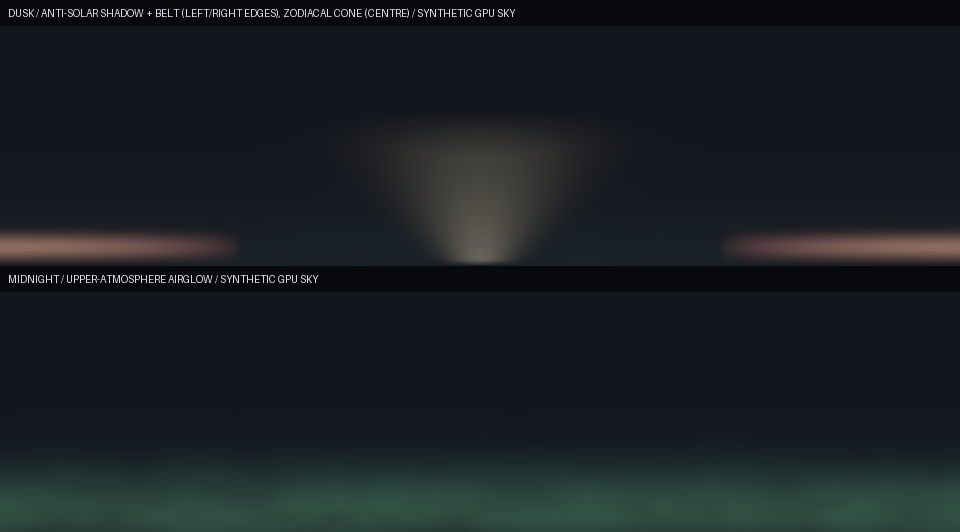

**1.15.2 — torch flicker fix:** Material IDs now use flat interpolation, preventing floating-point interpolation errors from toggling torch emission. Other effects and settings are unchanged.

Galaxy Shader is a bright, warm-color shader pack for Minecraft Java Edition. It uses OpenGL rasterization, shadow mapping, and screen-space effects while keeping block outlines readable. No compilation step is required, no external noise textures are needed, and no extra resource pack is required.

**1.15.1 — night sky and warm sunlight:** Adds one continuous Milky Way sheet bound to the day/night rotation, analytic moon phases 0–7, and solar colour from three-band atmospheric transmittance driven by solar elevation. Low sun turns amber rather than magenta, the twilight band spreads wider toward the sun, and the aureole graduates from a warm core to a cool fringe. No menu options are added; the warm exposure, saturation and shade-fill defaults from 1.14.1 are unchanged.

After updating, **reset shader settings**, then select HIGH. Quality profiles alone do not reset saved exposure or saturation. Synthetic GPU checks passed; Minecraft gameplay appearance and FPS remain unverified.

**1.15.1 — rotating night galaxy (2026-10-26):** The Milky Way is now one continuous sheet bound to the day/night rotation. It rises from one horizon at dusk, crosses overhead near midnight and sets on the opposite side. Its structure follows wide-field sky photographs: a cool blue-white star sheet, a warm central bulge, a branched dust lane and Great Rift, sparse pink H-alpha regions and fine unresolved stars. Everything is analytic noise; no textures, tables or extra render targets are added. The pattern is anchored in the star-fixed frame, so the whole sheet rotates rigidly and never flickers. It develops after twilight and dims toward the horizon through atmospheric extinction. The default 0.25 strength is now more readable than the old band; adjust it under Cosmic Sky → Galaxy / aurora strength. Aurora and event strengths are unchanged. The image below is a synthetic GPU sky, not a gameplay capture.

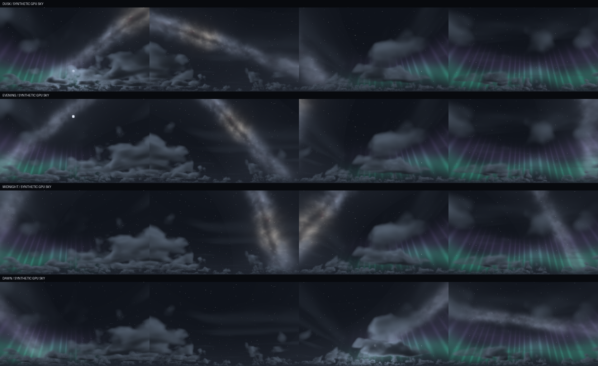

**1.15.1 — procedural moon phases (2026-10-26):** The night moon is now analytic: phases 0–7, a soft terminator, maria and crater mottling, faint earthshine and a cool halo around the limb. Directional moonlight follows the illuminated fraction — brightest at full moon and nearly absent at new moon — and rain or thunderstorms dim the disk. The disk and halo are evaluated from the view direction only, with no textures or extra render targets. The image below shows a full-moon night and phases 0–7 (synthetic GPU sky, not a gameplay capture).

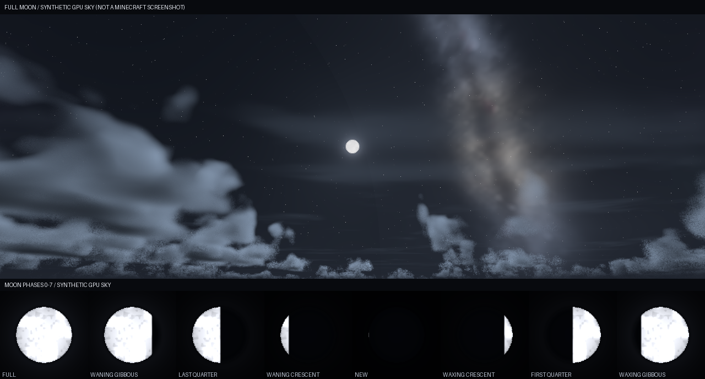

**1.15.1 — warm sunlight (2026-10-26):** Solar colour now comes from a three-band atmospheric transmittance: Rayleigh scattering, Mie extinction and ozone absorption are integrated with solar elevation, so a low sun turns naturally amber. Ozone retains enough green to keep the sky from drifting magenta. The twilight warm band spreads wider toward the sun, and the solar aureole graduates from a warm core to a cool fringe while direct-light brightness and shade contrast stay unchanged. Everything is analytic; no textures, lookup tables or render targets are added. The image below is a 1.14.1 (left) versus 1.15.1 (right) synthetic A/B, not a gameplay capture.

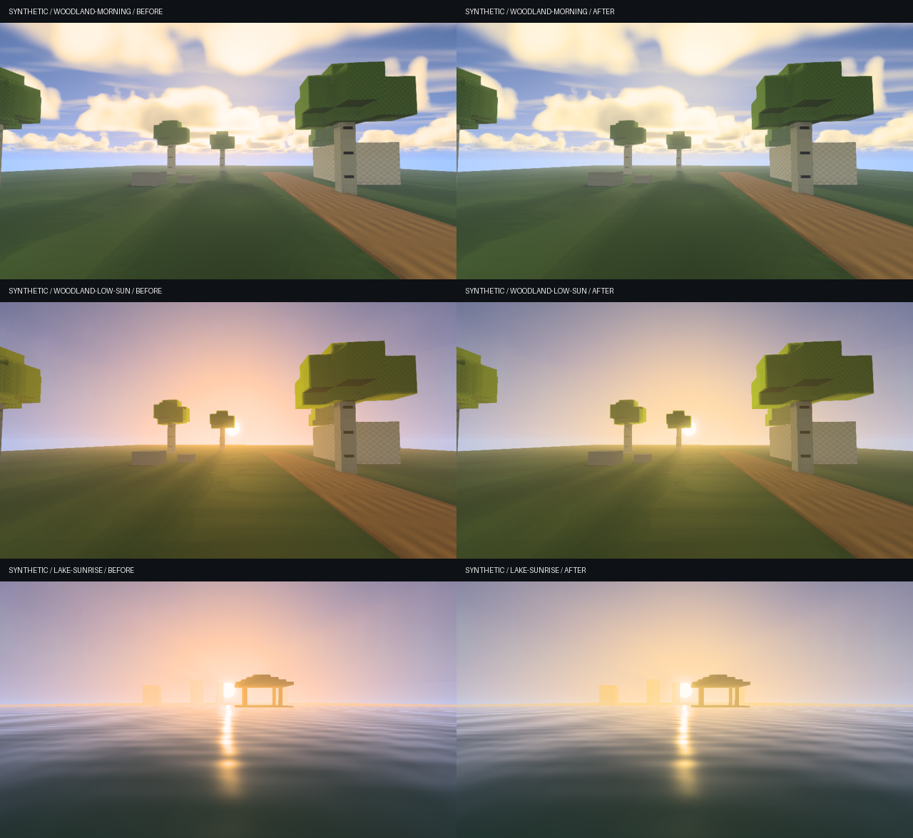

The following notes describe earlier releases; the installed package you run remains authoritative.

**1.14.1 — bright warm palette:** Warm golden daylight replaces the neutral sun, sky fill loses its strong blue bias and outdoor shade receives more sky and ground bounce. Fixed exposure defaults to **1.25**, saturation to **1.1**, with contrast at **1**. White balance runs before tone mapping so bright neutral surfaces approach white smoothly. Foliage stays green, the sky stays blue, and sky-light/AO gates still reject outdoor bounce in closed caves. No extra texture samples or march steps are added.

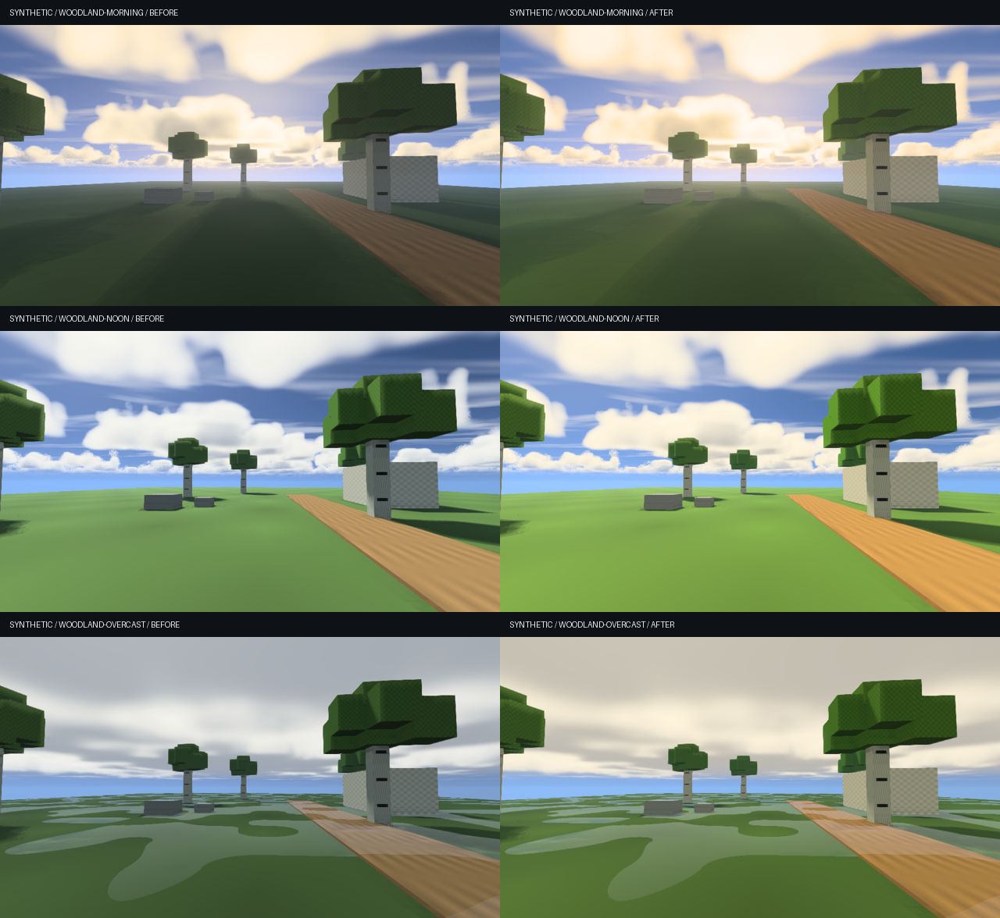

**1.14.0 — Photon parameter calibration:** The supplied Photon 1.3 defaults inform a 2-degree sun radius shared by the visible disk and PCSS penumbra, 0.8 cloud-shadow strength and fixed exposure at 1. Daylight changes chroma with solar elevation; cool sky fill and a small warm bounce shape outdoor shade. Low morning mist halves every seven blocks above Y=69. Warm twilight is more local, with a blue dome and pink horizon after sunset.

Reset all settings before selecting HIGH. Selecting a profile alone does not reset personal sun-radius, cloud-shadow or exposure settings. New controls are Lighting → Sun angular radius and Clouds → Cloud shadow strength. See the [parameter mapping](REFERENCE-PHOTON.md).

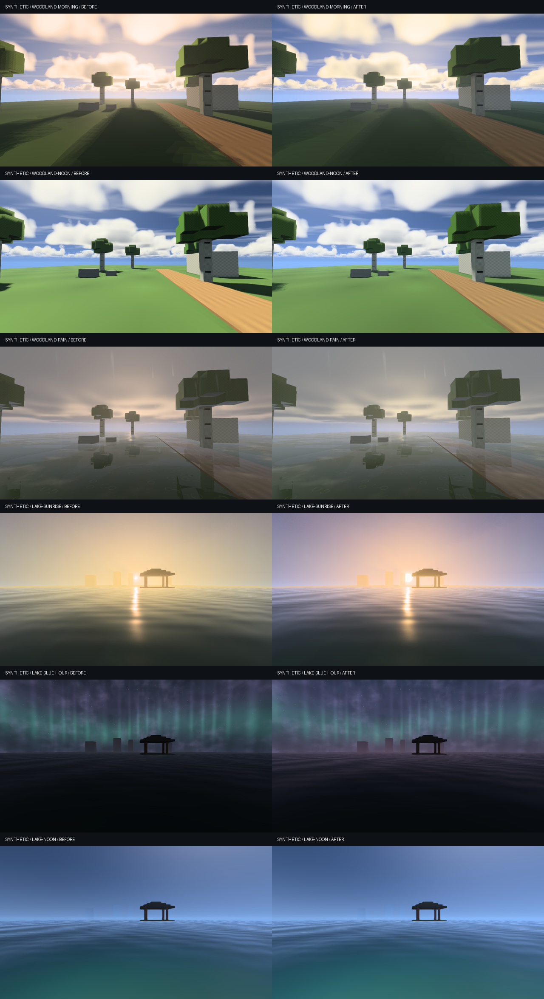

**1.13.1 — sunny daylight:** Low-angle sunlight previously suffered both air-mass attenuation and a horizon fade while diffuse sky fill stayed strong. This update removes the double suppression, strengthens and gently warms direct sunlight, and confines warm twilight scattering closer to the sun and horizon. Sunlit grass, wood and leaf edges separate more clearly from cool shade. A compact aureole surrounds the solar disk and remains behind clouds. Volumetric visibility moments now share optical-weight normalization, preventing uniformly lit air from generating artificial shafts. Rain still attenuates direct light.

**Sunrise / sunset:** Low solar elevations produce an amber lower sky, depth-dependent golden mist and a wave-broken solar path on water. The golden atmosphere fades out by a sun elevation of about 13 degrees. `DAWN_HAZE` controls the extra dawn mist (default 1); 0 removes that mist while retaining sunrise sky colours.

Reset settings and start with HIGH. `SUN_INTENSITY=1.0` already uses the new sunny calibration; try 0.75 for softer lighting or 1.25 for stronger sunlight. Keep exposure at 1.0. Previews are synthetic; gameplay appearance remains to be checked.

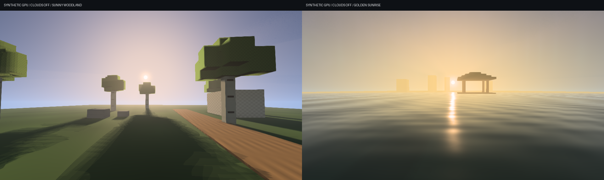

**1.13.0 — natural lighting, inspired by Photon:** Daylight is more neutral at noon and attenuates with low sun elevation. Surfaces, water and volumetric clouds share a directional sky-fill model; shadowed faces keep cool detail, and foliage gains shadow-constrained transmission. A thin high cloud layer sits behind cumulus. PCSS derives penumbra from world-space blocker separation. Clear dawn haze is lighter, and terrain fog no longer overlays the sky a second time. Water uses an IOR of 1.333, clearer shallows and blue-green depth; shoreline foam responds to lighting. Galaxy/aurora strength defaults to 25%, while stars and the End sky retain their identity. Soft-knee bloom and gently desaturated highlights keep bright surfaces restrained. These effects are implemented independently in this project.

New controls: `SKYLIGHT_STRENGTH` (Lighting, default 1), `SHADOW_SOFTNESS` (Shadows, 1.25), `WATER_CLARITY` (Water, 1), `BLOOM_STRENGTH` (Post Processing, 1), and `COSMIC_SKY_STRENGTH` (Cosmic Sky, 0.25). Cosmic Sky and Seasons are now reachable from the root menu. Reset to defaults or start with HIGH after installation, then adjust to taste; higher water clarity reduces absorption.

1.13.0 synthetic GPU preview (not a Minecraft capture):

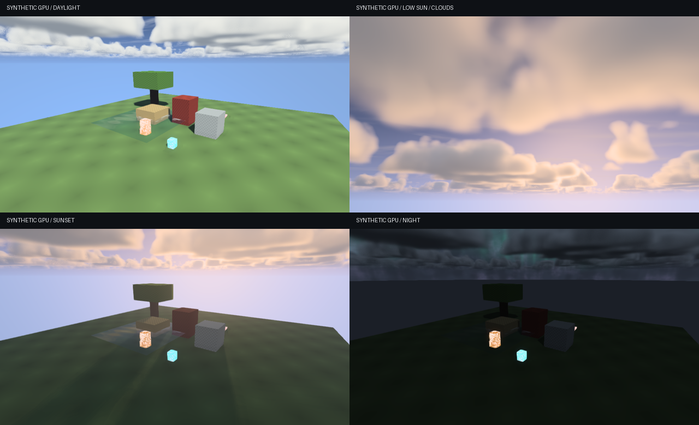

**1.12.3 — clear-morning fix:** A clear sunrise or sunset no longer renders like overcast weather. Three terms independent of the sun elevation were brightening the whole sky: the isotropic constant in the volumetric light, the shaft term that carried no view-direction weight, and the dawn haze coefficients, which cut clear-morning visibility to roughly a quarter. On top of that, the cloud-coverage setting doubled as an overcast switch and dimmed the sunlight and sky with it. The sky-side isotropic term is now about an eighth of its old value, shafts are weighted by a forward phase (`0.10 + 0.90·cos²`, so sunward god rays are unchanged), dawn height/valley fog density and the warm-haze blend are halved, cloud coverage only adds clouds while the density threshold and cirrus weight are tightened, and the warm atmospheric band stays near the horizon on the sun's side. New Atmosphere-page option `DAWN_HAZE` (0 / 0.5 / 1 / 1.5 / 2, default 1): 0 is a crisp clear sky, 2 restores a heavy morning fog bank.

**1.12.1 — parameter alignment against Photon 1.3 defaults:** Ambient occlusion now uses a 2-block world radius with 12 samples at High instead of 18; PCSS shadows follow the reference pack's "three blocker samples plus six to twelve filter taps" range, cutting a lit fragment from 20 to 14 shadow fetches; water adopts its per-block absorption coefficients (water column 0.39/0.14/0.07, underwater 0.20/0.08/0.04) so deep water keeps its blue-green instead of crushing to black and underwater visibility improves; volumetric light mirrors the reference shaft budget by halving its samples once the view is well above the horizon. Every one of these is an equivalent parameter reimplemented here - no Photon code was copied.

**1.12.0 — End rework and Photon-style performance pass:** The End centrepiece is no longer a black hole or wormhole. The former event horizon, photon ring and accretion disk are replaced by a **rift core**: a faceted crystal core, four long diffraction streaks, two counter-facing plasma jets, and two belts of shattered shards driven by angular sectors (each shard hashes its own radius, thickness and tint, and some sectors stay empty). The silhouette is spiked and segmented rather than a round horizon with a smooth dust disk. The giant's limb glow and ring dust move to cold violet-silver tones to match the new ambient light. Budgets across reflections, clouds, water and volumetrics were rebalanced: clouds drop fine noise detail in the far part of the march and use 16/24/36 direct-sky steps, with two longer light samples replacing three short ones; reflections use a single cloud sheet instead of a second volumetric march; water reflects the analytic sky by default and optional screen-space hits moved to the new `WATER_REFLECTIONS` option (on for ULTRA/CINEMATIC); water refraction is one displaced lookup plus at most one extra tap. Cumulative 1280x720 HIGH A/B against 1.11.2: clouds -37.2%, sunset -37.3%, daytime terrain/water -36.9%, rain -51.0%, underwater -36.6%; mean 8-bit difference 0.73-1.18 for clouds/sunset/day/rain and 2.99 underwater (the visible result of the absorption change), and the water draw itself is roughly 90% cheaper. Report: `validation/performance-report.json`; this is not Minecraft FPS.

**1.11.2 — Overworld performance:** Preserves direct-sky cloud detail, shadow resolution, volumetric light and SSR. Medium/High cloud shadows use low-frequency density with mean fine-detail compensation; reflected clouds use half the view steps. Colored light rejects non-emissive samples first, and indirect light skips zero-contribution shading.

**1.11.1 / 1.11.0:** Removes the six legacy End planets and their orbital dust tracks, leaving the ringed giant, the central object and a fixed starfield, and upgrades clouds to three-dimensional billows with edge erosion. The black hole centrepiece of those releases was replaced by the rift core in 1.12.0.

Start with HIGH; use ULTRA for finer clouds. Golden-hour rays require low sunlight and scene occluders. Bundled previews are synthetic GPU renders of the actual shaders, not Minecraft captures or a claim of pixel-identical reference matching.

## Delivery status

The first feature set is implemented and has passed standalone GPU compilation and synthetic-scene render checks. Full in-game acceptance on Minecraft + Iris and measured FPS data are still pending. No claim is made about every GPU or mod combination.

## Previews

1.12.1 synthetic GPU views (not Minecraft captures):

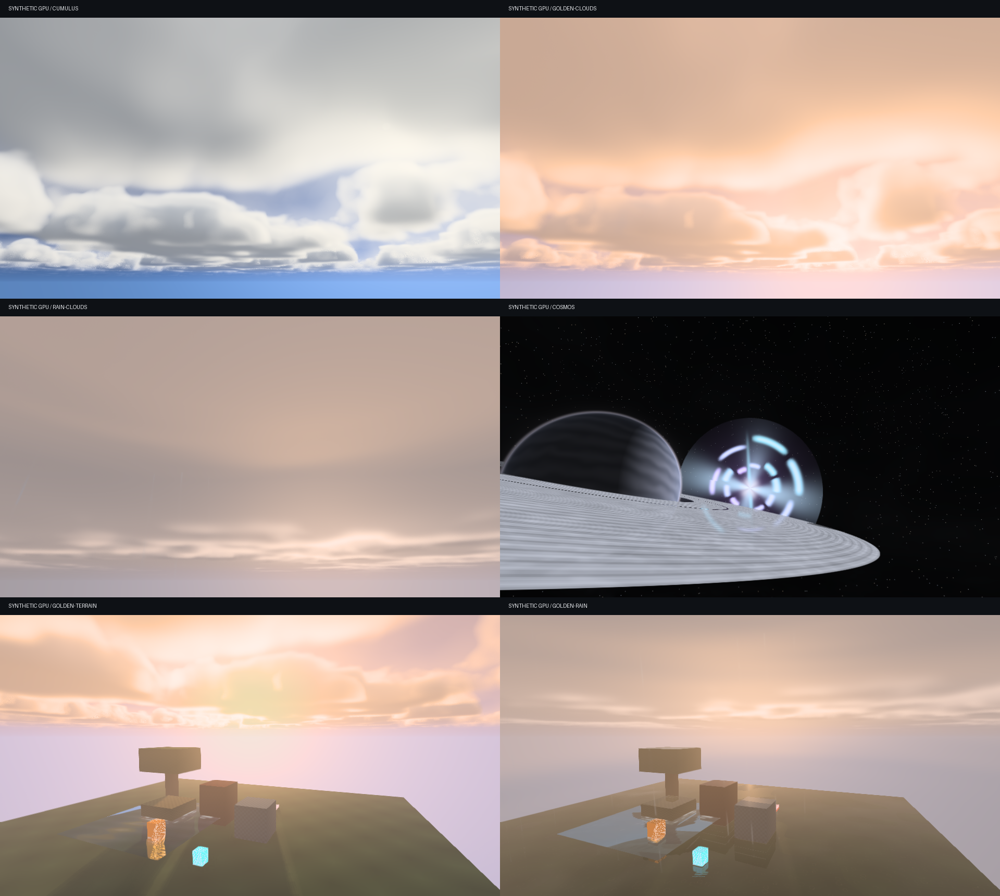

**1.5.0 — weather and atmosphere update:** Adds a dedicated procedural precipitation pass that uses the game's rain geometry while replacing its visible streaks with wind-driven layers, near/far density, and lightning response. Water receives multi-scale expanding and fading ripple rings; upward, sky-exposed block surfaces receive small splash impacts. Stone, paths, wood, and foliage darken smoothly with Iris `wetness`, lose roughness, and gain reflections. Clouds, sky, sun, fog, terrain, water, and volumetric accumulation now respond together to Clear / Cloudy / Rain / Thunderstorm. Dawn/dusk volumetrics ray-march the shadow map and use alternating lit/occluded samples to form shafts through canopy gaps, with automatic midday reduction and an energy cap. Terrain fog combines height fog, lowland/valley noise, and distance haze, stopping at scene depth so foreground walls remain opaque.

**1.6.0 — volumetric clouds, colored light, rainbow, and daily sky variation:** Overworld clouds are upgraded to a ray-marched volumetric field whose base and thickness respond to rain/storms, with forward self-shadowing and silver-lining scatter; low presets keep the single-plane fallback. Emissive blocks now project screen-space colored light onto visible geometry, controlled by `COLORED_LIGHT_QUALITY`. A post-rain rainbow was added, and sky, cloud coverage, and fog density now vary by calendar day.

**1.7.0 — cosmic sky and End planet update:** The End planetary system now has seven planets with dramatically spread orbits, obvious near/far apparent size and orbital-speed differences, and axial rotation decoupled from orbital motion. The Overworld night sky gains a tilted Milky Way band with colored nebulas, low northern aurora, occasional shooting stars, and a distant banded planet, controlled by `COSMIC_SKY_QUALITY`.

**1.7.1 — aurora and shooting-star tuning:** Removes the faint distant planet from the Overworld night sky; the northern aurora is brighter, taller, and more layered, and shooting stars occur more often.

**1.7.2 — softer lighting:** Reduces automatic exposure gain, direct sun intensity, daytime ambient light, and block light, while raising the bloom threshold and lowering bloom strength for a gentler, less blown-out image.

**1.7.3 — volumetric cloud blending:** Reworks the cloud density curve with a wider soft threshold and two soft vertical lobes, adds sky ambient color and horizon/distance soft transitions, and removes the hard detail cutouts for a more integrated sky.

**1.7.4 — water and underwater visibility:** Rain/wind now blur the refracted underwater background and raise surface reflection, making it harder to see into water from land. Underwater vision gains distance blur and stronger absorption, so the surface and land lose focus and become murkier with depth.

**1.8.0 — seasons:** Adds `SEASON_MODE` (Auto / Spring / Summer / Autumn / Winter) and `SEASON_STRENGTH`. Auto follows the calendar year and continuously drives sky, sunlight, ambient light, fog, cloud coverage, and foliage color; a specific season can also be forced for screenshots or themed worlds.

**1.8.1 — End celestial rework:** The seven planets now have far stronger orbit-distance and size contrast, with dust trails along each orbit. Planet night sides receive ambient fill so they no longer read as black holes. The central star is replaced by a single wormhole (dark event horizon, photon ring, and tilted dusty accretion disk), and the ringed giant's rings use layered radial bands and noise clumps instead of a solid ring.

**1.9.0 — celestial events and biome atmosphere:** Adds `CELESTIAL_EVENTS`: calendar-driven meteor showers, comets, aurora storms, a solar eclipse and a rare supernova. Adds `BIOME_BLEND`: temperature and rainfall now shift regional mood — warm desert haze, humid jungle/swamp fog, and colder blue light with stronger aurora in cold biomes.

**1.9.1 — water and cave depth:** Underwater gains blue-green god rays and flowing caustics, shorelines gain wind-driven foam, and water refraction uses stronger depth parallax. Caves gain a faint bioluminescent ambient and drifting motes for more depth in the dark.

**1.10.0 — particles, cloud types, extended weather, surface seasons:** Adds `PARTICLE_LAYER` (pollen/dust, fireflies, spores, snow, hail, embers, cosmic motes), `CLOUD_TYPES` (cumulus/stratus/cirrus/storm anvil), `WEATHER_EFFECTS` (sandstorms, blizzards, fog banks) and `SURFACE_SEASONS` (winter frost/snow, patchier autumn leaves, rain puddles, summer heat shimmer).

**1.4.0 — temporal stability update:** Adds configurable HDR TAA history with camera/depth/screen rejection and a 3×3 YCoCg neighborhood clamp; contact-hardening PCSS shadows; world-radius directional horizon AO; SSR adaptive stepping, thickness handling, hit confidence, and rough reflection resolve; Legacy Filmic, ACES-like, and AgX-like tone mapping; more restrained exposure and bloom; and TAA-aware volumetric jitter. Projection jitter remains disabled to protect hand rendering and Iris compatibility.

End rift core and ringed giant close-up:

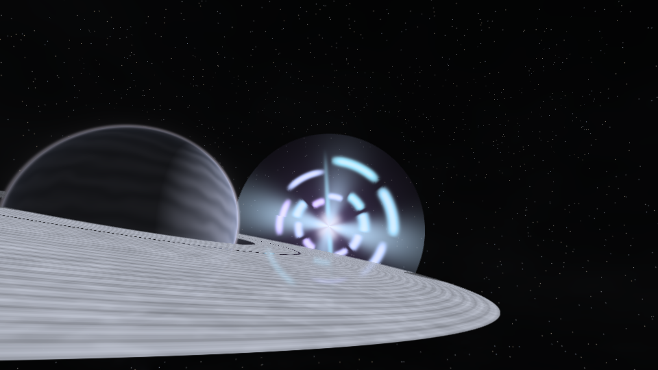

**1.3.0 — End planet visual upgrade:** The four End planets now have independent orbits and silhouettes: inner planets orbit faster, outer ones slower, and each has its own orbital distance and apparent size; the ringed giant's rings scale with its radius. Every planet gains a procedural atmospheric glow that peaks at the silhouette, falls off into a soft haze, and keeps only a narrow rim over the disk edge so surface colors stay intact. Glow color and strength vary by planet type (cold blue ocean world, volcanic orange, amber ringed giant, icy blue outer world), with stronger scattering on the side facing the central star. The full GPU compile matrix, all synthetic-scene render regressions, and the End-sky fixture checks were rerun and passed. In-game acceptance and FPS measurements are still pending.

**1.2.0 — performance update:** Overworld cloud shadows are now evaluated per vertex and interpolated, instead of recomputed per fragment with FBM; water fragments return early before the generic lighting pass, removing work that was previously overwritten; PCF shadow sampling drops to 4 taps beyond 60% of the shadow distance, in addition to the existing distance fade. These changes passed the full GPU compile matrix and all synthetic-scene render regressions. In-game acceptance and FPS measurements are still pending.

**1.1.0 — End planetary sky:** Four orbiting planets (including one ringed giant), a central star, and a fixed starfield were added to the End. Movement is driven by view direction and time, with configurable orbital/rotational speed. `END_PLANETS` and `END_ORBIT_SPEED` options were added under a new "End starfield" menu page (Chinese and English), enabled by default and limited to the End dimension. Six synthetic-scene checks passed (foreground occlusion, orbital motion, frozen at zero speed, clock reset consistency at 0.5/1/2× speed, static when disabled, no leakage to other dimensions); in-game acceptance is still pending.

**1.0.2 — buffer format fix:** Buffer-format metadata was moved into Iris-supported multiline comments, fixing `RGBA16F` / `RGBA8` / `R11F_G11F_B10F` being treated as undefined GLSL variables in `deferred.fsh`. The validator no longer injects format macros that the release does not contain. Iris is confirmed to allocate all 7 buffers as expected.

**1.0.1 — clear-color crash fix:** Fixed a load-time crash caused by Iris parsing single-argument `vec4` clear colors. The four clear colors now use four explicit components and pass parsing against real Iris 1.10.9 and 1.11.2 releases.

## Requirements

- Target game: Minecraft Java Edition **26.2**.
- Fabric with the **Iris 1.11.2 + 26.2 Fabric build** and **Sodium 0.9.1 for 26.2**.
- OpenGL 3.3 / GLSL 330 or newer compatibility profile, converted by Iris for the game's core pipeline.
- GPU verification device for this round: NVIDIA GeForce RTX 5080 Laptop GPU, driver 616.64, OpenGL 4.6.
- Minecraft 26.3, Vulkan, OptiFine, Distant Horizons, Voxy, and custom rendering mods are not claimed to be supported.

## Installation

1. Install Minecraft Java 26.2 with the matching Fabric, Iris, and Sodium builds (or use the [Iris installer](https://irisshaders.dev/download/) and select the game version).
2. Put **Galaxy Shader-1.15.45.zip** into that instance's `.minecraft/shaderpacks/` folder. Do not extract it.
3. Launch the Fabric instance and open `Options → Video Settings → Shader Packs`.
4. Select `Galaxy Shader-1.15.45.zip` and click `Apply`.
5. Open the shader settings and choose `HIGH` or `MEDIUM`. Menu labels are provided in both Chinese and English.

The source folder is also installable: copy the whole `Galaxy Shader` directory into `shaderpacks/` so the path resolves to `shaderpacks/Galaxy Shader/shaders/shaders.properties`. Inside the ZIP, files live directly under `shaders/` with no extra nesting.

## Features

| System | Implementation |
| --- | --- |
| Lighting | Dynamic sun/moon direction, warm sunrise/sunset tint, weather attenuation, hemispheric ambient light, minimum cave brightness, held-light approximation |
| Shadows | Stable-grid orthographic map, PCSS blocker search, contact-hardening variable penumbra, static sample rotation, far-distance sample reduction and fade |
| Sky | Rayleigh/Mie phase and optical-thickness approximation, sun/moon disks, stars, day-night gradient, Overworld galaxy band and nebulas, aurora, shooting stars, calendar-driven celestial events, anti-solar Earth shadow and Belt of Venus, zodiacal light, night zodiacal band and gegenschein, night airglow, 22° ice halos with parhelia and a sun pillar, a 46° ring and circumhorizontal arc, sunset green flash, anti-solar rays |
| End sky | Rift core (faceted crystal core, four diffraction streaks, bipolar plasma jets, two belts of shattered shards), one ringed giant and a fixed starfield; `END_PLANETS` / `END_ORBIT_SPEED`, End only |
| Clouds & weather | Ray-marched volumetric clouds (far samples drop fine noise detail, single-plane fallback on low), cumulus/stratus/cirrus/storm-anvil cloud types, noctilucent high cloud bands, winter nacreous clouds, sandstorms/blizzards/fog banks, rain streaks, post-rain rainbow, rainy-night moonbow, daily sky variation, smooth wetness accumulation, block splashes, real lightning illumination |
| Air particles | Daytime pollen and dust, night fireflies, forest spores, snow-biome snow, storm hail, Nether embers and End cosmic motes; selected by biome, season, weather and dimension |
| Water | Multi-frequency wave normals (up to three layers), multi-scale expanding/fading rain rings, wind/storm disturbance, storm highlights, Fresnel, analytic sky reflection (`WATER_REFLECTIONS` can add traced hits), one displaced refraction lookup plus one extra tap, Beer-Lambert absorption, shoreline foam, underwater caustics and blue-green volumetrics, deep-water fog |
| Reflections | SSR for wet or LabPBR smooth surfaces; adaptive stepping, thickness/refinement, hit confidence, inexpensive rough resolve, environment fallback |
| Vegetation | Grass, flowers, crops, leaves, vines; world-coordinate and gust-driven motion; matching animation for tall-plant halves and the shadow pass |
| AO / indirect | Directional GTAO-style horizon search with world radius and edge-aware weighting; separate short-range color transport |
| Materials | LabPBR normals, linear roughness, dielectric F0/metal, material AO, emissive read; vanilla parameters when no resource pack provides them |
| Emissives | Torch, lantern, soul fire, lava, redstone, sea lantern, end rod, campfire, lit furnace and other classified emissives; visible emissive surfaces project screen-space colored light onto geometry |
| Atmospheric fog | Depth-occluded height fog, lowland/valley fog, distance haze, and weather/humidity response, with biome temperature/rainfall shifting fog colour and density; warm volcanic fog in the Nether; dark nebula and void fog in the End |
| Volumetric light | Shadow-map ray marching, canopy-contrast shafts, dawn/dusk boost with midday suppression, cloud attenuation, and lightning scatter |
| Post-processing | Restrained HDR bloom, Legacy Filmic / ACES-like / Natural Filmic mapping, bounded exposure and natural white balance |
| Camera | Reprojected TAA history, rejection and YCoCg neighborhood clamp; optional light FXAA, depth of field and camera motion blur |

## Recommended settings and quality presets

Default is `HIGH`: 2048 shadow resolution, 128-block shadow distance, soft shadows, moderate reflections and bloom. Start at 1080p and a 16-chunk render distance, then adjust from the actual frame rate. The table below is a quality budget, not a performance guarantee.

| Preset | Shadow map / distance | Effect budget |
| --- | --- | --- |
| POTATO | 1024 / 64 | TAA/PCSS/SSR/AO/indirect/volumetrics/advanced weather/terrain fog off; four-tap PCF |
| LOW | 1024 / 96 | Low TAA, AO, rain ripples, and terrain fog; PCF; SSR/indirect/volumetrics off |
| MEDIUM | 2048 / 96 | Medium TAA/weather; low PCSS/GTAO/SSR/volumetrics/terrain fog |
| HIGH | 2048 / 128 | Default; high TAA/weather and medium PCSS/GTAO/SSR/volumetrics/terrain fog; 24-step clouds; water reflects the analytic sky |
| ULTRA | 4096 / 192 | Maximum weather/terrain fog and higher PCSS/GTAO/SSR/volumetric budgets; 36-step clouds; water adds traced hits |
| CINEMATIC | 8192 / 256 | 16+24 PCSS, maximum weather/atmosphere/screen-space budgets and screenshot DoF; water adds traced hits |

Lowering `SSR`, `Volumetric Light`, `Cloud quality`, and shadow resolution is usually the fastest way to cut cost. Keeping water reflections on "Sky only" is far cheaper than "Sky + screen space", so leave the default when chasing frame rate. A single 8192² 32-bit depth map is roughly 256 MiB before other Iris targets and caches. Do not use CINEMATIC as a daily setting.

## LabPBR resource packs

`LabPBR materials` defaults to **Auto**: extra material textures are sampled only when a resource pack declares LabPBR through `texture.properties`. Without a resource pack these textures are not sampled, avoiding wrong defaults causing abnormal highlights.

If you are sure a pack is LabPBR 1.3 but does not declare the format, choose **Force LabPBR**. Do not force it on ordinary resource packs. `_n` reads RG normals and AO from the B channel; `_s` reads smoothness from R, reflectance/metal from G, and emissive from A; an emissive alpha of 255 is correctly ignored. Parallax occlusion, displacement, and subsurface texture channels are not implemented.

## Known limitations

- In-game acceptance is still pending; GPU tests use synthetic block scenes and do not include Iris runtime shader translation, real chunk streaming, game UI, mod interoperability, or player input.
- SSR can only reflect **opaque** content already on screen; off-screen content uses an environment approximation. Water refraction is based on the opaque scene; refraction through multiple glass/water layers is not solved recursively.
- Water reflects the analytic sky by default (`WATER_REFLECTIONS` = Sky only), so on-screen trees, hills and buildings do not appear in the water. Choosing "Sky + screen space" adds those traced hits and costs noticeably more at the water pixels.
- A single shadow map is used rather than cascaded shadow maps; thin glass/water does not cast colored shadows. Far shadows fade to sky-lit occlusion; extreme terrain still needs real-game inspection.
- Indirect light and emissives are approximated. Vanilla lightmaps carry no source color; the new colored light comes from screen-space propagation of visible emissive surfaces and cannot reach off-screen or fully occluded sources, so it does not equal Photon's voxel flood-fill / colored GI.
- Overworld clouds are ray-marched along the view ray rather than a 3D voxel cloud field, and distant samples keep only the large billow shape. Flying above the cloud layer, world-coordinate resets, and long-distance travel still need real-game inspection.
- Minecraft/Iris directly exposes Clear, Rain, Thunder, and continuous `rainStrength` / `wetness`. The pack derives its Cloudy mood continuously from configured cloud cover, residual wetness, and light attenuation; it does not add a new game weather type. Surface splash exposure uses skylight and face orientation, so per-drop occlusion under complex overhangs remains approximate.
- TAA does not jitter the projection; moving entities have no dedicated motion vectors and rely on depth, luminance, and neighborhood rejection. Auto-exposure still uses Iris's smoothed eye light rather than a full-scene histogram.
- Terrain and block entities support material normals; ordinary entities and armor do not have full LabPBR reads. Named metals use matching F0 for direct specular highlights, with an Albedo-metal approximation for environment reflections.
- The HUD is not blurred by default; post-processing applies to the world view. The held item has its own mask, but GUI, third person, enchant glints, beacons, and special objects still require in-game acceptance.
- Emissive regions are approximated through material textures or block type/brightness thresholds; fine-grained emissive detail such as furnace sides is less precise than dedicated PBR emissive maps.

## Troubleshooting

- **Pack does not appear in the list:** verify it is in the current launcher instance's `shaderpacks/`, and that the ZIP has `shaders/` at its root.
- **Compile error or black screen:** first disable the shader pack to restore the image, then confirm the Iris/Sodium builds match 26.2. Keep the first shader error from `.minecraft/logs/latest.log`, plus your GPU model and preset, to help diagnose.
- **Too bright or odd reflections:** set `PBR_MODE` to Auto or Off, and check whether the resource pack really is LabPBR.
- **Low frame rate:** switch to MEDIUM/LOW, lower reflections, volumetric light and shadow distance, and disable DoF/motion blur.
- **Screenshot too dark/too bright:** adjust Exposure; disable Eye Adaptation if you need a fixed exposure.
- **Grey, overcast-looking morning or dusk:** start with `Dawn/dusk haze` (`DAWN_HAZE`) on the Atmosphere page. The default is 1; 0 gives a crisp clear sky and 2 restores a heavy fog bank. Then check that `Cloud coverage` is not set very high - coverage now only adds clouds instead of dimming the sunlight and sky with them.
- **Missing off-screen reflections:** that is the screen-space reflection range limit; the pack already includes an environment fallback.

## License / credits

The shader source and documentation are original and released under the [MIT License](Galaxy Shader/LICENSE). No GLSL or textures from other shader packs were copied. The release ZIP does not contain Minecraft, Iris, Sodium, or third-party assets.

Interface references: [Iris docs](https://shaders.properties/current/) and the [LabPBR standard](https://shaderlabs.org/wiki/LabPBR_Material_Standard). Lighting uses public mathematical models such as Fresnel, GGX, Rayleigh/Mie, and Beer–Lambert. The filmic curve is a common ACES fit, not full ACES color management.

Project structure and validation workflow: [ARCHITECTURE.md](Galaxy Shader/ARCHITECTURE.md) · release history: [CHANGELOG.md](Galaxy Shader/CHANGELOG.md) · validation records: [VALIDATION.md](Galaxy Shader/VALIDATION.md)
