# Galaxy Shader

**Photorealistic Minecraft Shader · 1.15.39 · Community Project**

**1.15.39 低配优化：洞穴与室内跳过天空雾采样（2026-11-03）：** 地形雾会用一次完整的天空散射采样给远雾上色。在洞穴、室内或其他天空光为 0 的位置，室外权重精确为零，这次采样随后会被乘成零，但着色器此前仍会完整计算大气散射、日月光晕与夜间天空层。现在这类像素直接跳过天空采样，只保留原有的洞穴雾颜色；室外像素（白天、黄昏、夜晚）与天空标记路径逐像素不变。该优化没有新增选项，也没有减少任何可见效果，对长期在洞穴与建筑内活动的低配玩家收益最明显。

**1.15.38 帕里弧（2026-11-03）：** 太阳高度约 13°–32° 时，22° 晕正上方出现一条很淡的弧形光带：中央高出日心约 25°，向两侧伸展约 25° 后两端下垂、重新贴近晕顶，形成类似浅 V 字或「太阳洞穴」的形状；弧体近似白色，下缘略带红橙、上缘偏淡紫。它需要竖直排列的片状冰晶，因此比切弧更罕见、更淡。归入已有的「大气 → 46° 晕与环地平弧」开关，不新增选项；沿用既有冰晶可见度（晴朗、非降雨、太阳在地平线以上）门控，太阳过高或过低时自动退出。纯角度解析的方位包络、抛物线高度与竖直高斯带，不增加贴图、查表或渲染目标。下图为合成 GPU 高空全景，弧亮度经预览放大，不是游戏截图。

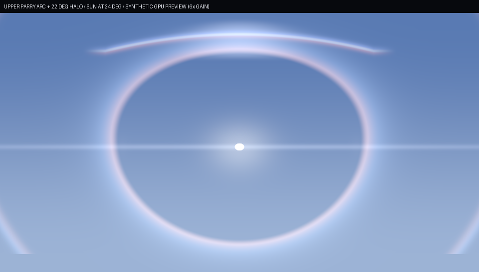

**1.15.37 低配优化：全阴天时跳过卷云层噪声（2026-11-03）：** 高空卷云的透明度按「1 − 阴天度」缩放，全阴天时精确为零，但着色器此前仍会计算一次 warp 噪声、一次 2–4 层 fbm 与一条正弦条纹。现在阴天度达到 99.9% 时卷云层直接返回原天空，雨暴与厚阴天不再为完全看不见的卷云付出噪声开销；晴朗与薄云天气的卷云外观逐像素不变。该优化没有新增选项，也没有减少任何可见效果。

**1.15.36 低配优化：低档 TAA 历史钳制改为五采样十字（2026-11-03）：** TAA 质量设为 1 时，历史颜色钳制不再读取 3×3 的九个像素，而是只读中心与上下左右四个邻点，每像素少四次纹理采样。对角线是移动边缘最不容易命中的方向，低档因此只牺牲极少量对角运动的钳制余量；质量 2/3 仍使用原来的 3×3 盒式钳制，逐像素不变。该优化没有新增选项，也不改变任何可见效果范围。

**1.15.35 低配优化：泛光强度归零时跳过全部泛光通道（2026-11-03）：** 把「泛光强度」拉到 0 后，原有着色器仍会执行 16 次采样的亮度提取、两次各 5 次采样的高斯模糊，并在最后再读一次泛光纹理，然后把结果乘以零。现在强度为 0 时三个泛光通道直接输出零并跳过共 27 次纹理采样；强度 1.0 的泛光画面逐像素保持不变。该优化没有新增选项，也没有减少任何可见效果；对低配玩家来说，关掉泛光现在真正省下整条后处理链。

**1.15.34 低配优化：丁达尔光强度归零时跳过体积积分（2026-11-03）：** 把「丁达尔光强度」拉到 0 后，原有着色器仍会为每个像素执行 8–40 次带阴影采样的体积积分，再把结果乘以零。现在强度为 0 时整段光柱积分直接跳过，只保留独立的雷暴闪光；水面下的光柱同样提前返回。默认强度 1.0 的画面逐像素不变，雷暴闪光在强度 0 时仍然出现。该优化没有新增选项；对低配玩家来说，关掉丁达尔光现在真正省下体积步进。

**1.15.33 低配优化：白昼星空提前退出（2026-11-03）：** 星点本来按「剩余夜色 × 晴空度」缩放，正午和全阴天时该系数精确为零，但着色器仍会为每颗像素计算星格哈希、闪烁正弦与恒星颜色哈希。现在系数低于 0.2% 时整段星空直接跳过，白昼天空路径每像素少做一组哈希、三次正弦与一组三角函数；夜晚与暮光的星点、闪烁和颜色逐像素保持不变。该优化没有新增选项，也没有减少任何可见效果。合成 GPU 对比中，正午画面与优化前、以及无星画面逐像素一致，深夜星点仍正常可见。

**1.15.32 低配优化：白昼宇宙天空提前退出（2026-11-03）：** 太阳升起后，银河、极光、流星、彗星与超新星等夜间宇宙层本来就会被白昼系数乘成零，但着色器此前仍会先计算它们的噪声。现在只要白昼系数低到 0.2% 以下（太阳升起或云层足够厚），整段夜间宇宙层直接跳过，正午与阴天天空不再为看不见的星空付出计算；黄昏、夜晚与日出日落的观感逐像素保持不变。该优化没有新增选项，也没有减少任何可见效果。合成 GPU 对比中，正午画面与关闭宇宙天空、以及优化前画面均逐像素一致。

**1.15.31 大气折射（2026-11-02）：** 太阳或满月贴近地平线时，不再是一枚标准正圆：整枚日面/月面被大气折射向上抬起，竖直方向同时收窄，而且下缘比上缘抬升得更多，因此低日呈现为略扁的椭圆。太阳低于约 17° 时才明显，升高后自动回到正圆；绿闪的绿色上缘也会跟着压扁后的上缘走。新增「大气 → 大气折射」开关（默认开启）；关闭后恢复正圆日面与月面。纯解析的折射抬升函数，不增加贴图、查表或渲染目标。下图为合成 GPU 日/月面对照，左关右开，不是游戏截图。

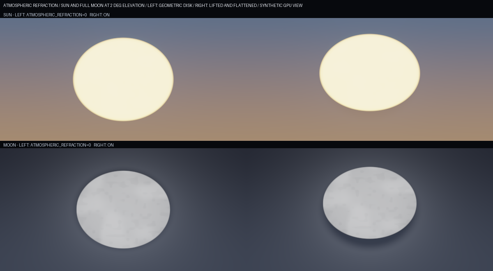

**1.15.30 毕晓普环（2026-11-02）：** 晴朗而略带尘埃的白昼天空里，太阳周围出现一圈极宽、极淡的尘埃光环：半径约 24°，内缘偏暖棕粉，向外渐变为冷蓝白，边缘柔和得几乎与天色融在一起；它比 22° 冰晶晕宽得多，也不会出现幻日或切弧。太阳贴近地平线、夜晚或阴天时不出现。新增「大气 → 毕晓普环」开关（默认开启）。纯角度解析的宽高斯环与暖冷插值，不增加贴图、查表或渲染目标。下图为合成 GPU 太阳特写，环亮度放大，不是游戏截图。

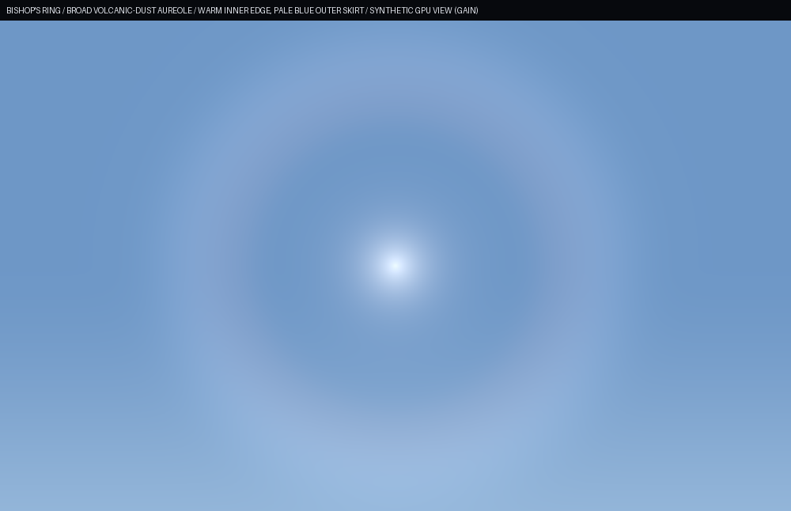

**1.15.29 云彩虹彩（2026-11-02）：** 太阳附近的高空薄云里出现柔和的粉彩色边：薄云中的细小水滴把阳光衍射成蓝、绿、粉、橙的弧形条纹，越靠近太阳越密，约 30° 外淡出。彩边只出现在破碎的薄云缝隙中，不会在晴空铺成完整同心圆；厚云、阴天和太阳贴近地平线时退出。新增「云层 → 云彩虹彩」开关（默认开启）。纯解析的破碎薄云遮罩与角度余弦，不增加贴图、查表或渲染目标。下图为合成 GPU 太阳附近天空，彩边亮度放大，不是游戏截图。

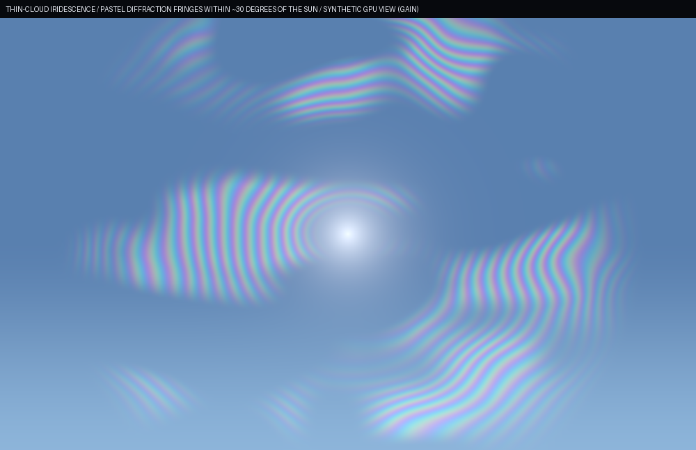

**1.15.28 极光帘幕褶皱（2026-11-02）：** 极光帘幕不再是一条平直的飘带：帘幕被折成数片大片下垂的褶皱，绿色下缘与紫色上缘一起上下起伏，细密光柱在褶皱收拢处变亮、展开处变暗，并随时间缓慢漂移。褶皱只作用于既有极光帘幕，不改变极光强度、出现条件或天顶光冕；白昼、阴天与南方天空照旧退出。新增「宇宙天空 → 极光帘幕褶皱」开关（默认开启）；关闭后恢复较平直的帘幕。纯解析的低频褶皱位移与相位调制，不增加贴图、查表或渲染目标。下图为同一片合成 GPU 北天极光的左右对照，右侧开启褶皱，亮度放大，不是游戏截图。

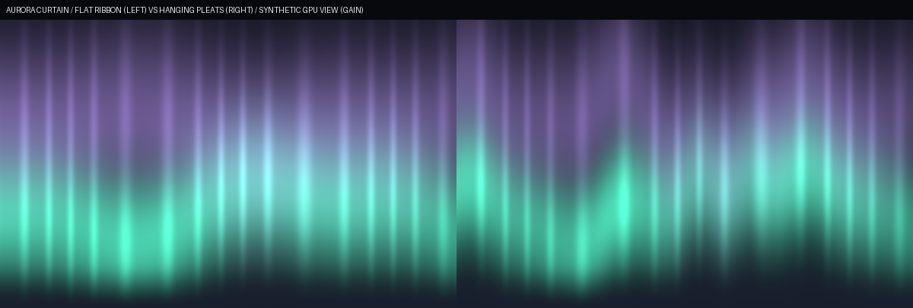

**1.15.27 夜光云波纹（2026-11-02）：** 夜光云不再只是一层平滑的蓝白云幕：云层内部出现两组斜向交叉的重力波列，波峰沿云絮弯曲，近地平处因透视被拉长，并随时间缓慢漂移。波纹只调制既有夜光云的亮度，不改变云量、颜色或出现窗口；白昼、深夜与阴天仍按原门控退出。新增「云层 → 夜光云波纹」开关（默认开启）；关闭后恢复较平滑的云幕。纯解析的双相位余弦与既有噪声扭曲，不增加贴图、查表或渲染目标。下图为同一片合成 GPU 夜光云的对照，右侧开启波纹，云层亮度放大，不是游戏截图。

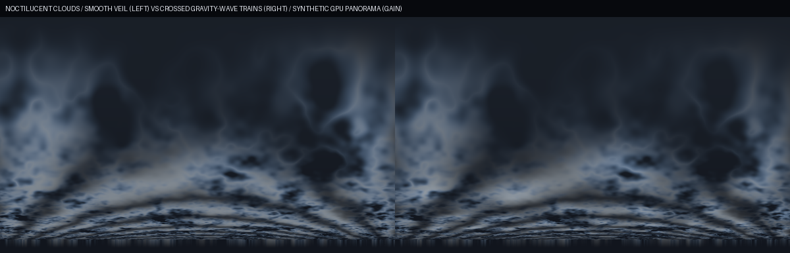

**1.15.26 气辉重力波波纹（2026-11-02）：** 夜间气辉不再只是一层平滑的绿青色光晕：约 10° 高度附近出现一组淡淡的水平条纹，像高层大气的重力波一样沿高度排列，并沿方位缓慢弯曲、整体缓慢漂移。条纹只叠加在既有夜间气辉上，白天、暮光与阴天仍由原门控压制，也不改变金星带、黄道光或星空。新增「大气 → 气辉波纹」开关（默认开启）；关闭后恢复原来的平滑气辉。纯角度解析的折叠余弦与方位扰动，不增加贴图、查表或渲染目标。下图为合成 GPU 全景，气辉亮度放大以便观察，不是游戏截图。

**1.15.25 恒星颜色（2026-11-02）：** 星点不再全部是同一个白色：每颗星根据自己的稳定哈希获得表面温度色，从暖橙、淡黄、近白到冷蓝白连续分布，并叠加独立的亮度差异，让暗星更多、亮星更醒目。颜色只作用于既有星点与闪烁，不改变银河、极光或流星。新增「大气 → 恒星颜色」开关（默认开启）；关闭后恢复原先统一的白色星点。每颗星两次哈希与一次色温插值，不增加贴图、查表或渲染目标。下图为合成 GPU 星空，星点经放大以便观察，不是游戏截图。

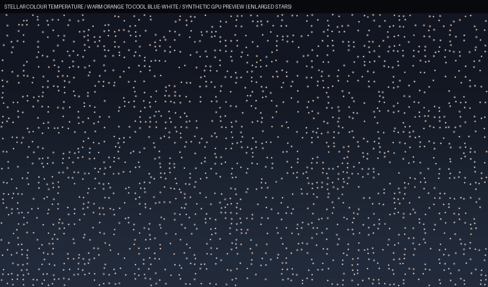

**1.15.24 日全食日冕与日珥（2026-11-02）：** 月面完全遮住太阳光球后，黑色月盘周围展开淡白色的日冕：弯曲的流苏向四周放射，赤道方向的冕流更宽，极区则收成细羽；月缘还点缀数处红色日珥，并随时间轻微起伏。日冕只在现有日食窗口的食甚前后出现，阴天被压制，日食结束后立即退出。与日食共用 `CELESTIAL_EVENTS` 开关，不新增选项。纯角度解析的极坐标流苏、径向衰减与月缘红色高斯，不增加贴图、查表或渲染目标。下图为合成 GPU 日食特写，日冕亮度经预览放大，不是游戏截图。

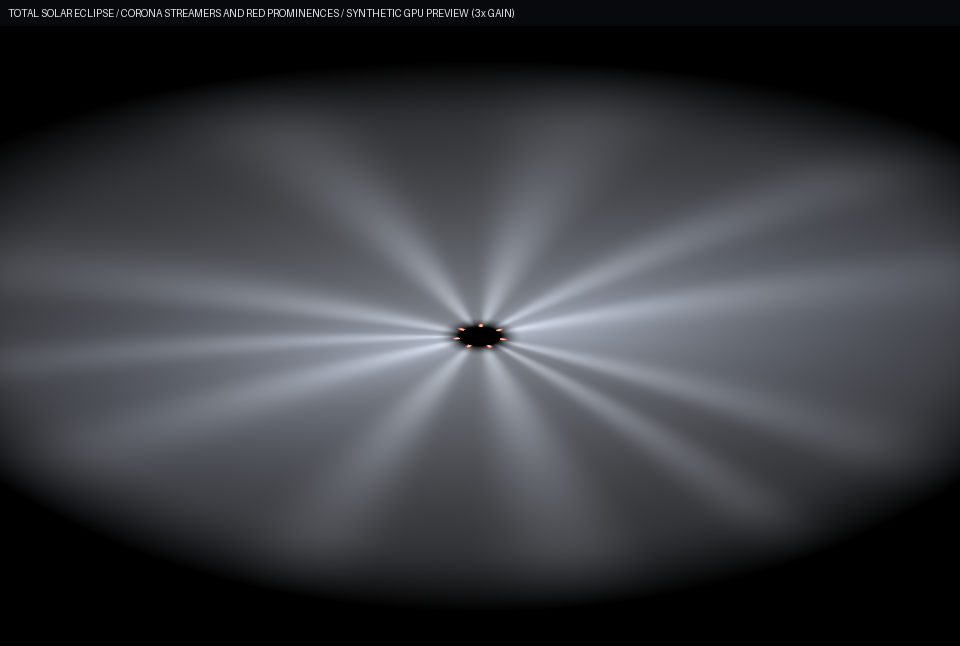

**1.15.23 流星余迹（2026-11-02）：** 明亮流星划过后，轨迹上不会立刻恢复黑暗，而是留下数秒的淡绿色余迹。余迹比流星本身更宽、更暗，沿轨迹分成缓慢漂移的结节，中段最亮、两端渐隐；它只在流星事件和夜晚晴空下出现，流星消失后才达到最亮，随后自然淡出。与流星共用 `COSMIC_SKY_QUALITY`、`CELESTIAL_EVENTS` 与夜晚/云量门控，不新增选项。纯角度解析的路径平面高斯与双频结节，不增加贴图、查表或渲染目标。下图为合成 GPU 夜空视图，余迹亮度经预览放大，不是游戏截图。

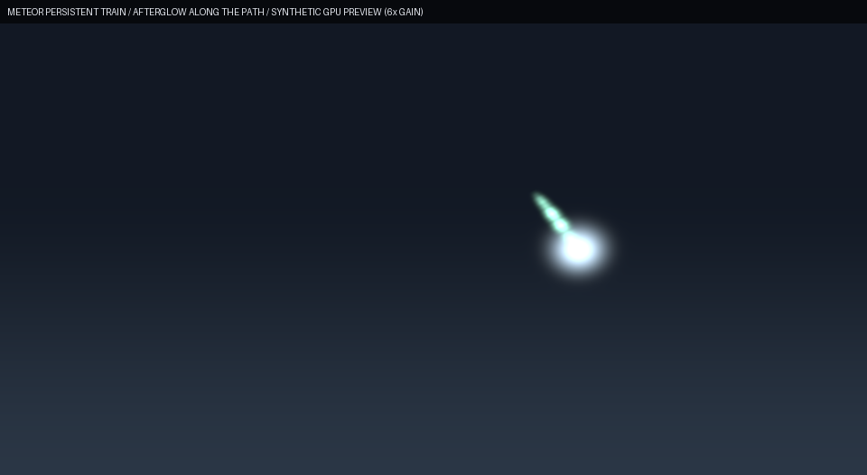

**1.15.22 月幻日与月切弧（2026-11-02）：** 低垂的明亮月亮照亮高空片状冰晶时，除了 22° 月晕与月柱，还会在晕的两侧各出现一个冷色、竖向拉长的月幻日，并在晕顶覆上一条淡淡的月切弧。月幻日与月切弧只在月亮低于约 23° 时出现，亮度约为同条件太阳幻日的一半，颜色明显偏冷；月亮升高后一起淡出。与冰晶晕共用 `ICE_HALOS` 开关，不新增选项。纯角度解析的方位/高度高斯与切弧包络，不增加贴图、查表或渲染目标。下图为合成 GPU 夜空全景，冰晶光晕亮度经预览放大，不是游戏截图。

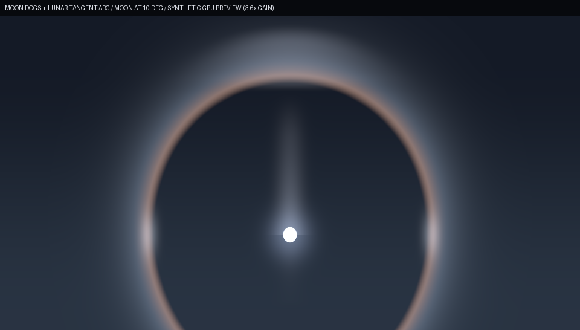

**1.15.21 彗星反尾（2026-11-02）：** 彗星活跃期，彗头附近除了背离太阳的普通尘埃尾，还会出现一条指向太阳的极细尘埃针——这是较大尘埃颗粒沿轨道面铺开、从侧视角度看到的反尾。反尾比尘埃尾窄得多，靠近彗头处最亮，随后迅速变淡，且在彗头背光侧不出现。它与现有彗星共用 `CELESTIAL_EVENTS` 天文事件开关和夜晚/晴空门控，不新增选项；纯角度解析的切平面高斯针与单调衰减，不增加贴图、查表或渲染目标。下图为合成 GPU 彗星视图，反尾亮度经预览放大，不是游戏截图。

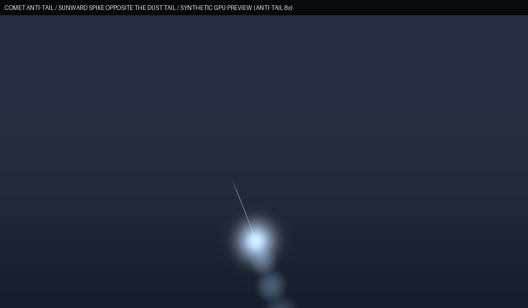

**1.15.20 极光天顶冕（2026-11-02）：** 极光活跃时抬头望向天顶，原本横跨天空的极光帘幕会聚成一圈向天顶汇聚的放射状光冕：中心偏绿、外圈渐带紫红，并随极光强度和时间缓慢起伏。与现有极光共用 `COSMIC_SKY_QUALITY`、`COSMIC_SKY_STRENGTH` 以及寒冷群系/磁暴门控，不新增选项。纯角度解析的折叠方位余弦与天顶软帽，不增加贴图、查表或渲染目标。下图为合成 GPU 鱼眼天顶视图，光冕亮度经预览放大，不是游戏截图。

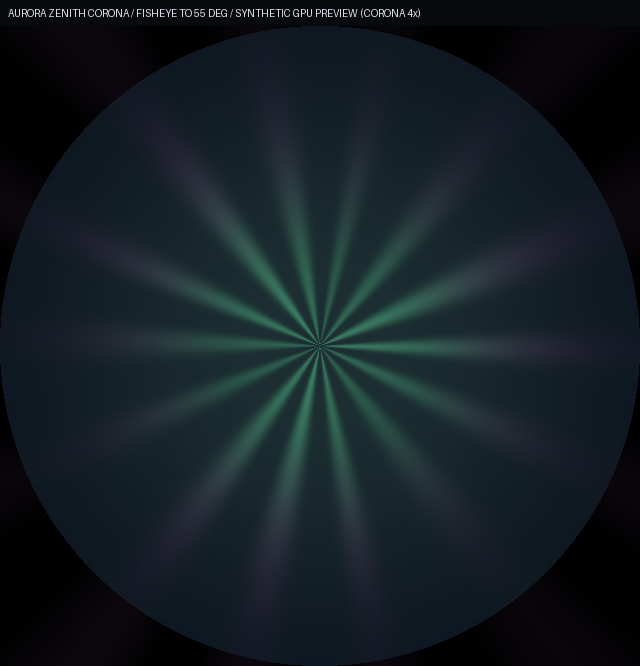

**1.15.19 白虹（2026-11-02）：** 雨停后空气仍潮湿、阴云未散时，雾中的细小水滴把折射虹抹成一条宽而近乎白色的 42° 反日弧，只留下很淡的冷色内缘与暖色外缘；太阳须在身后且低于约 42°，与正在降雨时的彩色主虹分开出现。新增 `FOGBOW` 开关（默认开启，天气设置页）。纯角度解析的径向带与少量色偏，不增加贴图、查表或渲染目标。下图为合成 GPU 雾天全景，虹弧亮度经预览放大，不是游戏截图。

**1.15.18 星光闪烁（2026-11-02）：** 星星不再恒定发亮：低层大气湍流让每颗星以独立相位和速率快速闪烁，靠近地平线时视线穿过更厚的大气，闪烁幅度更大；深夜、晴天时最明显，云层和月光仍会压暗星点。新增 `STAR_SCINTILLATION` 滑块（默认 1.0，大气设置页），设为 0 可让所有星星保持稳定。每颗星的相位与速率来自稳定哈希，纯解析计算，不增加贴图、查表或渲染目标。下图为同一片星空在两个时刻的合成 GPU 对照，闪烁幅度经预览放大，不是游戏截图。

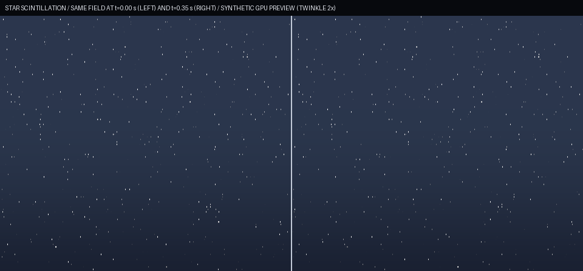

**1.15.17 环天顶弧（2026-11-02）：** 太阳低于约 26° 时，高空冰晶在太阳上方约 46° 处拉出一条明亮的彩色微笑弧，两端下沉、中央靠近天顶；红边在下、紫边在上，约 30° 以上逐渐消失。与 46° 晕、环地平弧共用 `ICE_HALO_COMPANIONS` 开关，不新增选项；只复用已有的冰晶可见度（晴天、非降雨）门控。纯角度解析的高斯带与方位包络，不增加贴图、查表或渲染目标。下图为合成 GPU 高空全景，弧亮度经预览放大，不是游戏截图。

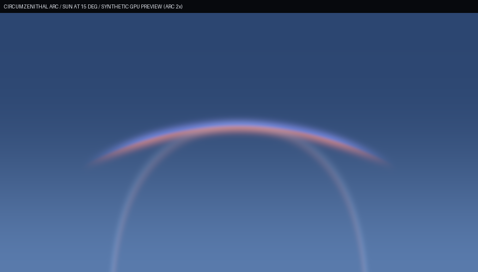

**1.15.16 月华（2026-11-02）：** 薄云中的明亮月亮周围出现一组紧凑的柔和衍射环，半径约 2°–8°，靠近月面偏蓝白、外侧渐暖；环纹随月相受照比例和夜晚亮度变化，阴天减淡，雨夜进一步抑制。新增 `LUNAR_CORONA` 开关（默认开启，大气设置页）。月华由云滴衍射而非冰晶折射产生，因此不依赖 `ICE_HALOS`。纯角度解析的径向余弦与软包络，不增加贴图、查表或渲染目标。下图为合成 GPU 夜空全景，环纹亮度经预览放大，不是游戏截图。

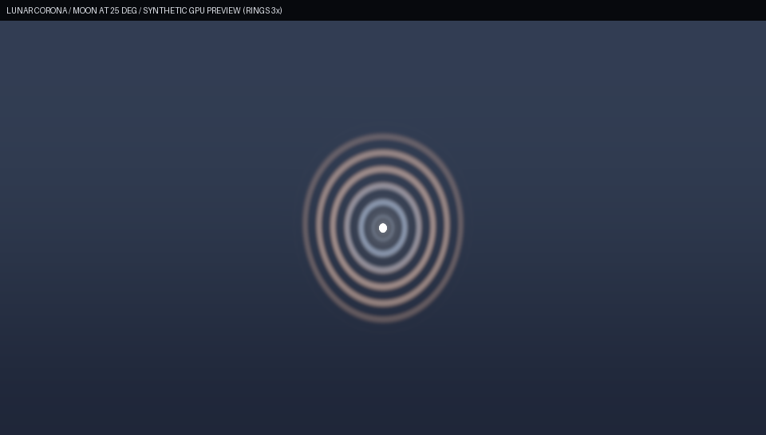

**1.15.15 干涉虹（2026-11-02）：** 主虹紫色内缘再往内约 2°–7°，出现数条极细的浅绿与浅粉交替条纹，这是形成主虹的光线之间的干涉，即「干涉虹」或「附属虹」。条纹只在主虹内侧原本已开始变暗的窄带里出现，离虹带即消失；同样受降雨/湿润、太阳高度和阴天门控。归入现有天气/彩虹系统，无新增选项；纯角度解析的阻尼余弦，不增加贴图、查表或渲染目标。下图为合成 GPU 双虹全景，干涉条纹亮度经预览放大，不是游戏截图。

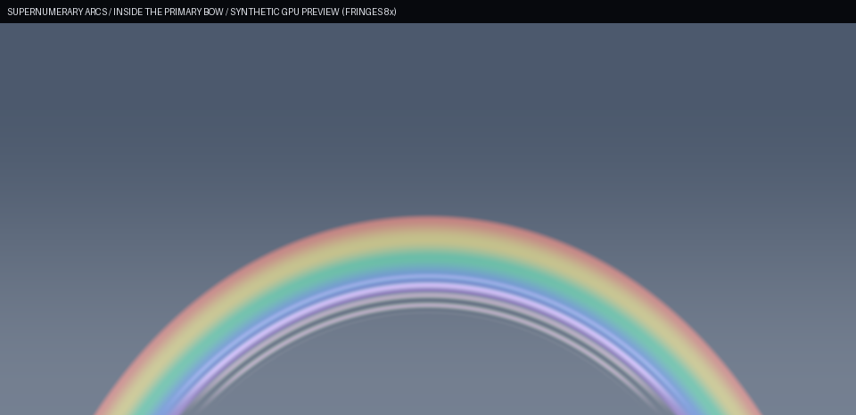

**1.15.14 副虹与亚历山大暗带（2026-11-02）：** 主虹外侧约 9° 处新增一条更淡的副虹，颜色顺序相反——红在内、紫在外；两条虹之间的天空比两侧略暗，形成亚历山大暗带。副虹只在下雨或雨后湿润、太阳高于地平线且天空未完全阴死时出现，亮度约为主虹的十分之一。归入现有天气/彩虹系统，无新增选项；纯角度解析计算，不增加贴图、查表或渲染目标。下图为合成 GPU 双虹全景，副虹亮度经预览放大，不是游戏截图。

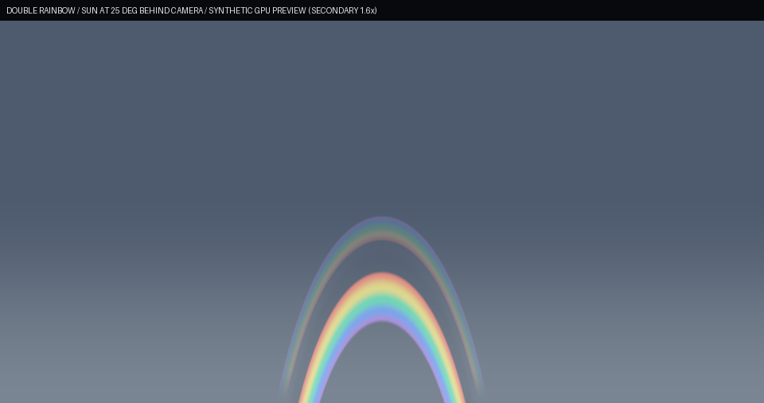

**1.15.13 月柱（2026-11-02）：** 低垂的明亮月亮也会被水平片状冰晶拉出一条窄而淡的冷色光柱，从月面向上延伸并在下方留下很短的倒影；月面越高，光柱越弱，月亮高于约 20° 后完全消失。与太阳柱共用 `ICE_HALOS` 开关，不新增选项；月柱只有日柱约一半亮度，且不产生幻日或上切弧。全部为角度解析计算，不增加贴图、查表或渲染目标。下图为合成 GPU 夜空全景，亮度经预览增益放大，不是游戏截图。

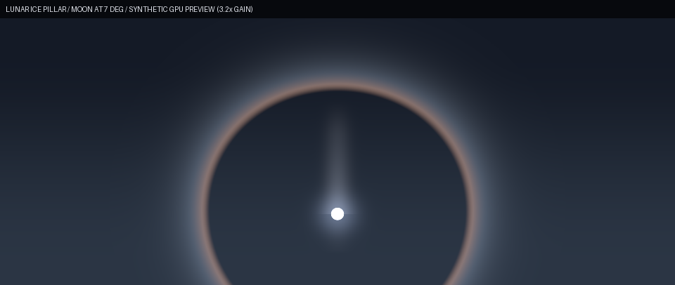

**1.15.12 幻日环（2026-11-02）：** 与太阳同高度的一条极淡白色水平光带横贯天空，穿过幻日并绕行整圈；靠近太阳处与 120° 幻日位置稍亮，其余部分非常柔和。它由水平片状冰晶产生，与 22° 晕、46° 晕和环地平弧共用晴朗冰晶天气，太阳低于地平线时退出。归入「大气 → 46° 晕与环地平弧」开关，无新增选项；纯角度解析计算，不增加贴图、查表或渲染目标。下图为合成 GPU 全景，亮度经预览增益放大，不是游戏截图。

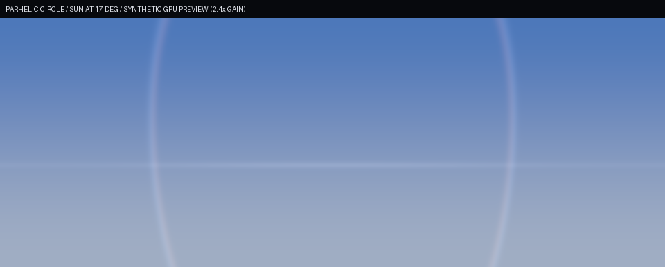

**1.15.11 46° 冰晶晕与环地平弧（2026-11-02）：** 22° 晕之外新增一圈更宽、更淡的 46° 冰晶晕，内缘偏红、外缘偏蓝。太阳升高到约 58° 以上时，水平排列的片状冰晶改为点亮「环地平弧」：太阳下方约 46° 处出现一条横贯天空的彩色光带，上缘偏红、下缘偏蓝紫，在太阳方位两侧最亮。两项都只在晴朗冰晶天气出现，太阳过低或阴雨时提前退出。新增「大气 → 46° 晕与环地平弧」开关（默认开启）；纯角度解析计算，不增加贴图、查表或渲染目标。下图为合成 GPU 高空全景，亮度经预览增益放大，不是游戏截图。

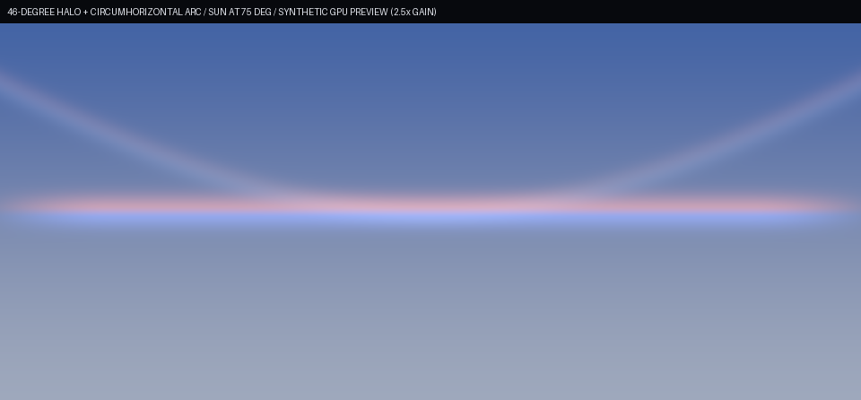

**1.15.10 反日点光辐条（2026-11-02）：** 太阳贴近地平线时，背向太阳的半边天空会出现一组极淡的明暗辐条，向反日点汇聚——这是云影投下的反曙暮光条。辐条只在太阳约 -6° 至 +14° 高度出现，太阳一侧的天空立即退出，阴天明显减弱；反日点附近留出暗核，靠近地平线的一侧最清楚。新增「大气 → 反日点光辐条」开关（默认开启）；全部为角度解析与少量程序噪声，不增加贴图、查表或渲染目标。下图为合成 GPU 反日侧全景，亮度经预览增益放大，不是游戏截图。

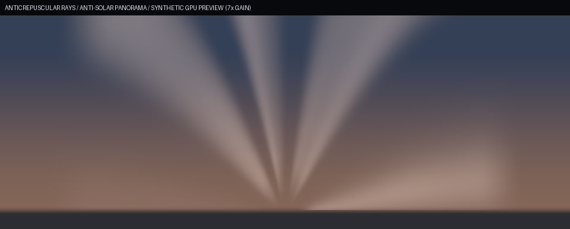

**1.15.9 绿闪（2026-11-02）：** 日落最后一度或日出最初一度，太阳上缘短暂出现一条青绿色细弧。绿闪只覆盖日面上半缘，并在同一位置轻微压暗暖色日面，避免加色被高光冲淡；太阳过高、完全落下或天气不佳时不出现。新增「大气 → 绿闪」开关（默认开启）；全部为角度解析计算，不增加贴图、查表或渲染目标。下图为合成 GPU 日面特写，亮度经预览增益放大，不是游戏截图。

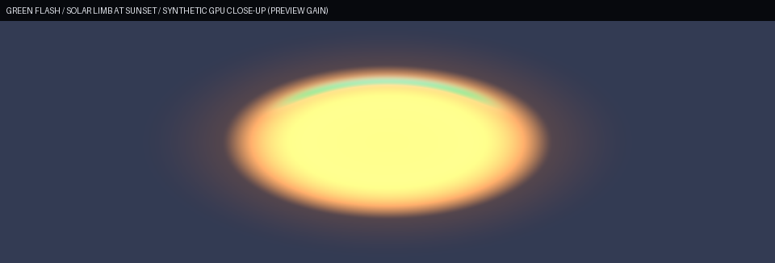

**1.15.8 珠母云（2026-11-02）：** 冬季暮光时分，高空出现柔和的透镜状珠母云，被衍射染成粉、绿、蓝渐变的珠光，靠近地平线最明显。云片在太阳低于地平线约 2°–13° 时出现，冬季远强于其他季节，晴朗天气才可见；与夜光云在高度、季节和色彩上区分。新增「云层 → 珠母云」开关（默认开启）；全部为解析噪声与三相位余弦着色，不增加贴图、查表或渲染目标。下图为合成 GPU 全景，亮度经预览增益放大，不是游戏截图。

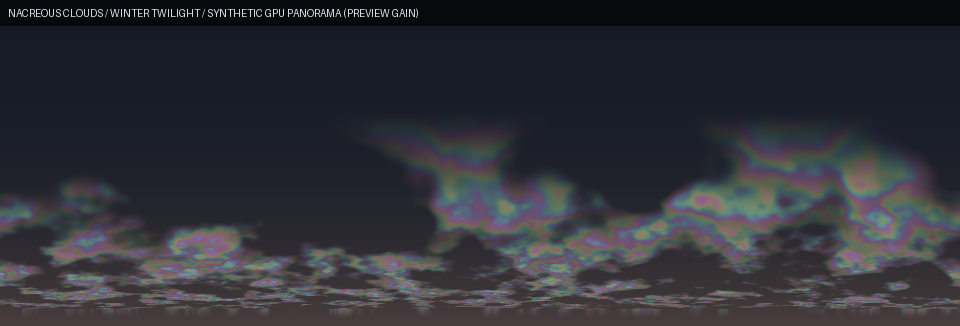

**1.15.7 黄道带与对日照（2026-11-02）：** 天文暮光结束后，黄道尘埃沿黄道形成一条淡银色光带；反日点附近出现更亮的椭圆对日照，沿黄道略长、横向较窄，颜色偏暖银，靠近地平线时淡出。黄道面由太阳方向与天球自转轴近似；外围光带偏冷，对日照偏暖。新增「大气 → 黄道带 / 对日照」开关（默认开启）；仅在太阳低于地平线下约 7° 后出现，阴天压制，全部为角度解析计算。下图为合成 GPU 夜空全景，亮度经预览增益放大，不是游戏截图。

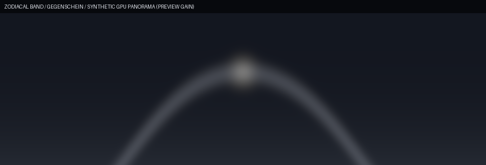

**1.15.6 月虹（2026-11-02）：** 雨夜月亮位于地平线上方时，反月点周围约 42° 出现一条淡银白色虹弧。它与日虹使用相同折射几何和雨后湿度，但颜色几乎全部去饱和并偏冷，只留极弱的色序；亮度随月相受照比例变化，新月与干燥天气不会出现。新增「天气 → 月虹」开关（默认开启）；全部为角度解析计算，不增加贴图、查表或渲染目标。下图为合成 GPU 雨夜全景，亮度经预览增益放大，不是游戏截图。

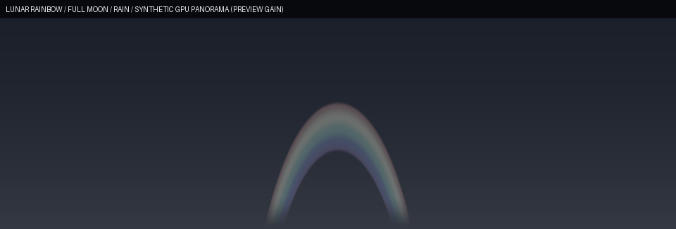

**1.15.5 冰晶晕（2026-11-02）：** 卷云冰晶在日/月周围形成半径约 22° 的细环，内缘偏红、外缘偏蓝；低太阳时环上出现两侧竖向拉长的幻日，晕顶带一条上切弧，贴近地平线时还有向上延伸的日柱。月亮只产生圆环，不出现幻日与日柱。新增「大气 → 冰晶晕」开关（默认开启）；全部为角度解析计算，约 35° 以外的天空像素提前退出，不增加贴图、查表或渲染目标。下图为合成 GPU 全景，亮度经预览增益放大，不是游戏截图。

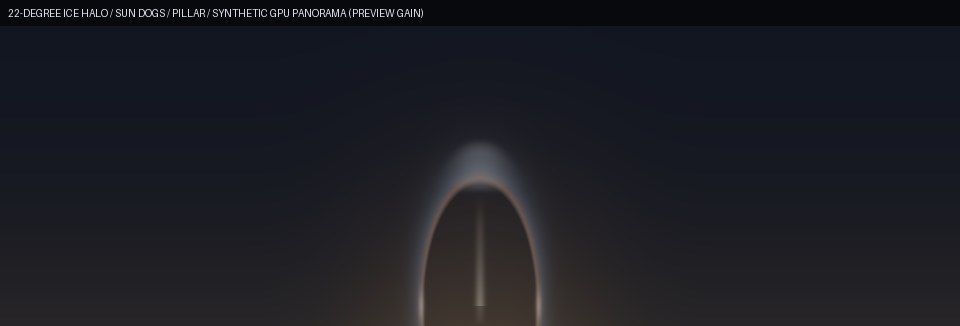

**1.15.4 夜光云（2026-11-02）：** 日落后低层天空已暗、中间层仍被阳光照亮时，地平线上方出现蓝白色、带缓慢波状纹理的高空云带；云层投影到水平面，具有随视线变化的透视拉伸，越靠近天顶越淡。夜光云在夏季最强，只在太阳高度约 -3° 至 -26° 的暮光窗口、晴朗天气和低空出现，并正确遮挡星空与银河。新增「云层 → 夜光云」开关（默认开启）；全部为解析噪声，不增加贴图、查表或渲染目标。下图为合成 GPU 全景，亮度经预览增益放大，不是游戏截图。

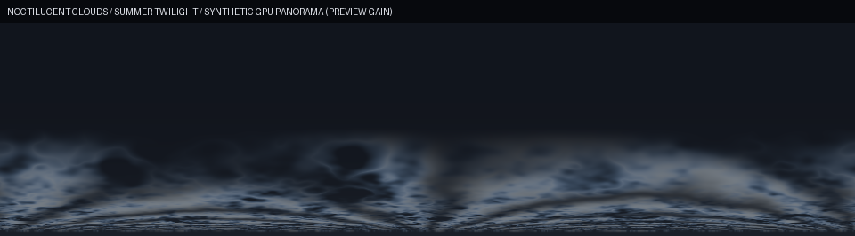

**1.15.3 晨昏光学现象（2026-11-02）：** 新增反日点地影与金星带、向阳侧黄道光锥和夜间气辉。太阳刚落到地平线下时，反日侧先出现冷蓝灰色地影楔形暗带，其上方是一层粉紫色金星带；黄昏后在太阳落点上方展开一条越往上越宽、越淡的银黄色黄道光；进入黑夜后，约 10° 高度出现缓慢起伏的绿青色气辉。三项共用一个「大气 → 晨昏光学现象」强度滑块（默认 1），云雨会压制它们；全部由角度与程序噪声解析求值，不增加贴图、查表或渲染目标。下图为合成 GPU 全景，亮度经预览增益放大，不是游戏截图。

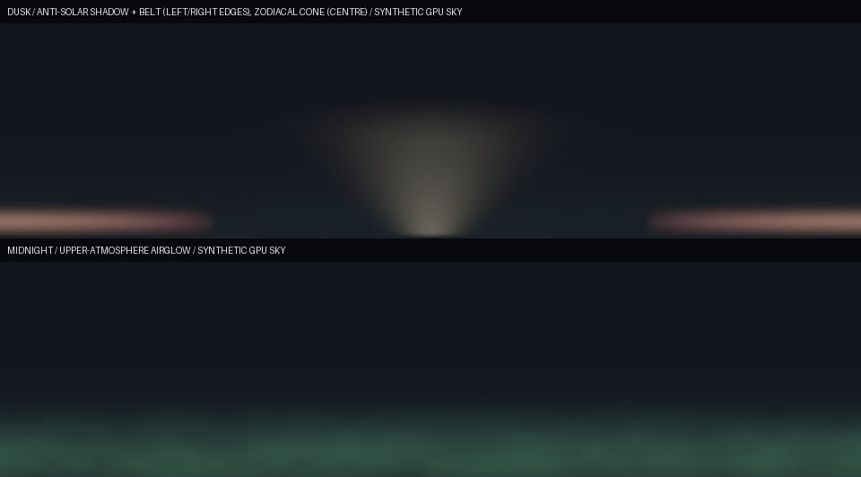

**1.15.2 火把闪烁修复：** 材质编号改为逐面恒定传递，避免浮点插值误差导致火把发光像素反复跳变。其他效果与设置保持不变。

明亮暖色方向的 Minecraft Java 光影包。使用 OpenGL 光栅渲染、阴影贴图和屏幕空间效果，保留方块轮廓。无需编译，不依赖外部噪声贴图，也不需要额外资源包。

**1.15.1 夜空与温暖日光更新：** 加入随昼夜旋转的整片银河、0–7 程序化月相，以及按太阳高度计算的三波段大气透射日光。低日呈暖金色而不偏洋红，晨昏暖带在向阳侧更宽，太阳光晕从暖色内核过渡到冷色外缘。没有新增菜单选项，1.14.1 的暖色曝光、饱和度与阴影补光默认值保持不变。

更新后先在光影设置中**恢复默认设置**，再选择 HIGH。只切换质量预设不会重置旧曝光与饱和度。合成 GPU 检查通过，实际 Minecraft 画面与 FPS 仍待验收。

**1.15.1 · 夜间动态银河（2026-10-26）：** 银河改为与昼夜同步的一整片天体：黄昏从一侧地平线升起，午夜横跨天顶，黎明在另一侧落下。层次参考真实宽场星空照片——冷蓝白星云带、暖白核球、分叉的暗尘带与大暗隙、少量粉色 H-alpha 区域和细密星点；全部由程序噪声生成，不增加贴图或渲染目标。银河纹理锚定在星空坐标系，旋转时整片刚性移动，不会逐帧闪烁；暮光后逐渐显现，靠近地平线时被大气消光压暗。默认 0.25 强度已比旧版更清晰，可在「宇宙天空 → 银河 / 极光强度」调整；极光与天象事件强度不变。下图为合成 GPU 天空，不是游戏截图。

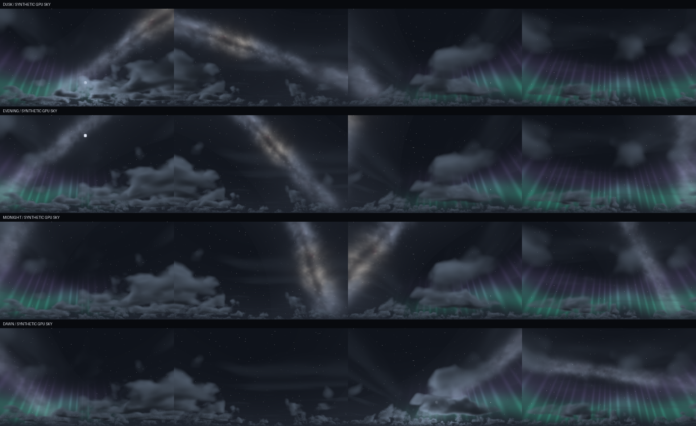

**1.15.1 · 程序化月相（2026-10-26）：** 夜空月盘改为程序化月球：0–7 月相、柔和明暗界线、月海与环形山纹理、微弱地照和贴近月缘的冷色月华。月光直射强度随实际受照比例变化——满月最亮，新月几乎无月光；阴雨与雷暴会压暗月盘。月相纹理与月华只按视线方向解析求值，不增加贴图或渲染目标。下图为满月夜空前情与 0–7 月相特写（合成 GPU 天空，不是游戏截图）。

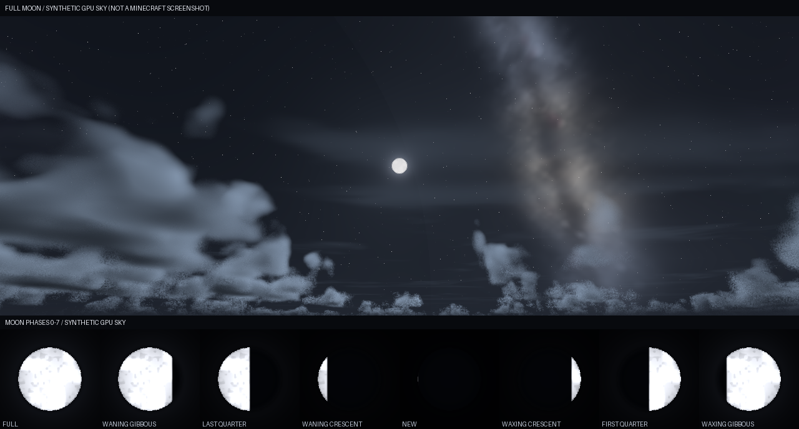

**1.15.1 · 温暖日光（2026-10-26）：** 日光颜色改由三波段大气透射计算：瑞利散射、米氏消光与臭氧吸收随太阳高度一起积分，低日自然呈现暖金色；臭氧保留适量绿色，避免天空偏洋红。晨昏暖光带在向阳侧铺得更宽，太阳周围的光晕由暖色内核渐变为冷色外缘，同时保留直射光原有亮度与阴影对比。全部为解析计算，不增加贴图、查表或渲染目标。下图为 1.14.1（左）与 1.15.1（右）的合成 A/B，不是游戏截图。

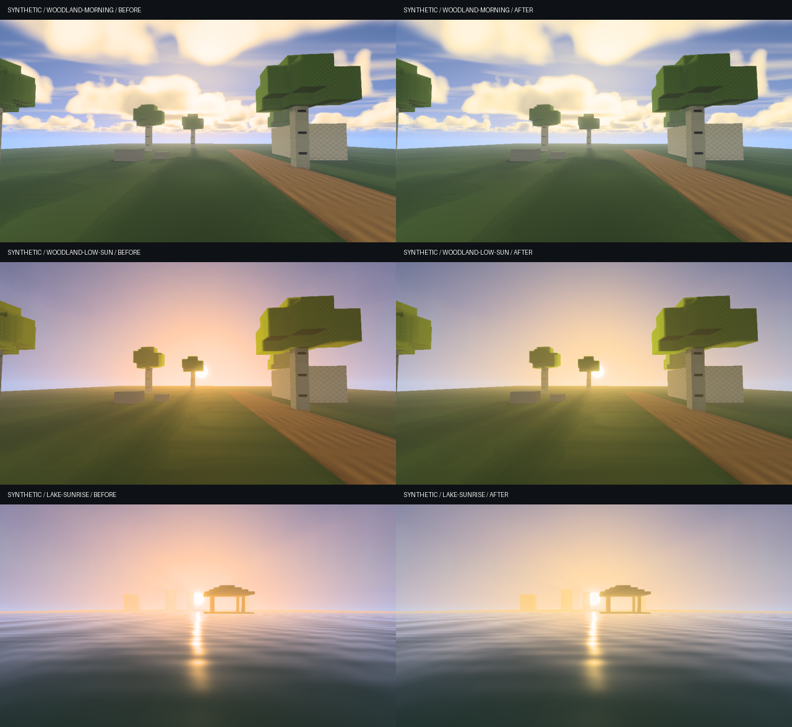

以下为先前版本记录；当前已安装效果以所使用安装包为准。

**1.14.1 暖色鲜明更新：** 白昼阳光改为暖金色，减弱天空补光的蓝色倾向，提高户外阴影与地面反弹光。固定曝光默认 **1.25**、饱和度 **1.1**、对比度保持 **1**；白平衡放在 HDR 色调映射前处理，让亮部仍能柔和过渡到白色。草木保留绿色、天空保留蓝色，封闭洞穴仍受天空光和 AO 约束。没有增加纹理采样或光线步数。

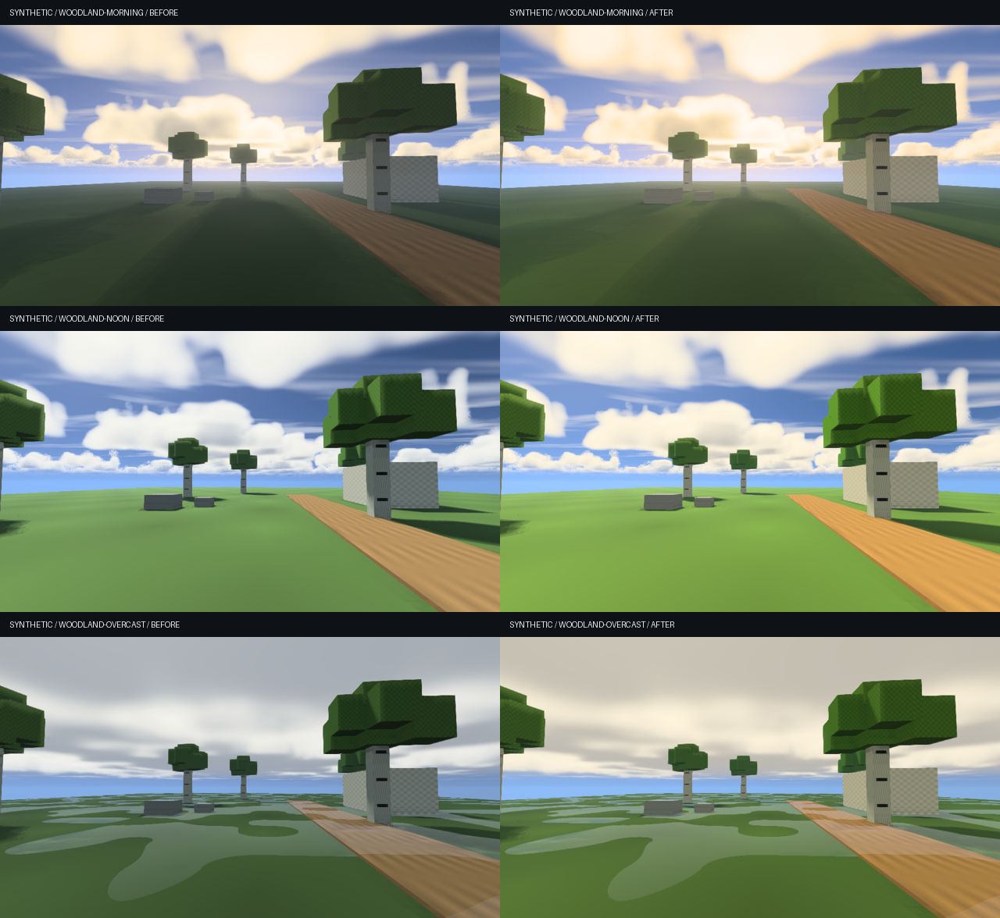

**1.14.0 Photon 参数校准：** 参考你提供的 Photon 1.3 默认值，将太阳角半径设为 2°，同时用于太阳盘和 PCSS 半影；云影默认强度为 0.8，自动曝光默认关闭，曝光保持 1。日光按太阳高度渐变，正午更中性、晨昏偏暖；树荫保留冷色天空补光及少量暖反弹。低地晨雾从海平面上 7 格开始每 7 格减半，天空的黄色范围收窄，日落后保留蓝调和局部粉色地平线。

安装后先恢复默认设置，再选择 HIGH；仅切换预设不会重置个人太阳半径、云影和曝光设置。新增菜单：「光照 → 太阳角半径」「云层 → 云影强度」。[详细参数映射](REFERENCE-PHOTON.md)。

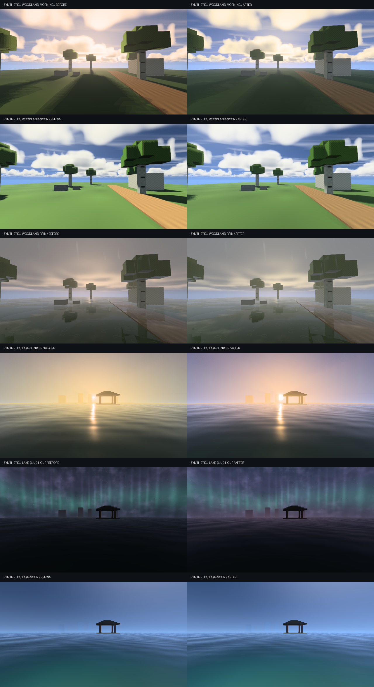

**1.13.1 明媚阳光更新：** 低角度太阳原先同时受到空气质量系数与地平线淡出衰减，导致直射光明显弱于天空补光。这次取消重复压暗、提高晴天直射光、略微暖化日光，并收紧晨昏暖色天空的范围。树荫保留冷色，草地、木板与树叶的受光面更亮；太阳周围增加局部柔光，云层仍能遮挡太阳。体积光现在按相同的光学权重计算均值和方差，均匀受光的空气不会生成额外光束，从而减少前景泛灰。雨天直射光依然受天气衰减。

**日出 / 日落：** 太阳贴近地平线时，低空自动转为琥珀金色，远处低地逐渐融入暖雾，水面沿太阳方向出现随细波移动的断续光带。太阳高度升至约 13° 后，金色氛围衰减完毕，恢复清透的白昼；不使用全屏橙色滤镜。`DAWN_HAZE` 可调晨昏暖雾强度，默认 1，0 关闭额外暖雾，天空日出颜色仍会保留。

安装后恢复默认设置并选择 HIGH；`SUN_INTENSITY=1.0` 已采用新的晴天亮度，喜欢柔和画面可降为 0.75，喜欢更强阳光可调至 1.25。曝光保持 1.0。预览为合成场景，游戏内效果仍需实测。

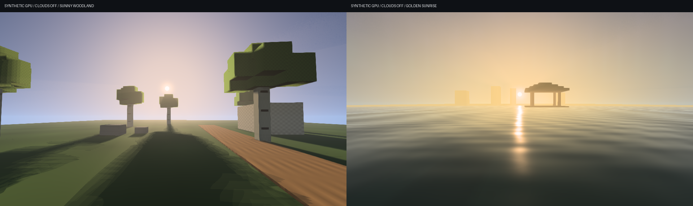

**1.13.0 自然光照更新（Photon 方向）：** 日光在正午更中性、晨昏随太阳高度衰减；地表、水体与体积云共用天空补光，背光面保留冷色层次，并为草叶加入受阴影约束的逆光透射。积云后方新增轻薄高层卷云；PCSS 根据遮挡物与接收面的世界距离计算半影。晴天晨雾减轻，天空不再重复叠加地形雾。水面折射率改为 1.333，浅水保留细节、深水逐渐偏蓝绿，泡沫会随昼夜和阴影变暗。银河与极光默认强度为原来的 25%，保留星星与末地特色；柔和泛光阈值和高光去饱和减少过曝色块。这些效果由本项目独立实现。

新增菜单选项：`SKYLIGHT_STRENGTH`（光照，默认 1）、`SHADOW_SOFTNESS`（阴影，默认 1.25）、`WATER_CLARITY`（水体，默认 1）、`BLOOM_STRENGTH`（后期，默认 1）、`COSMIC_SKY_STRENGTH`（宇宙天空，默认 0.25）。宇宙天空与四季页现在可从主菜单进入。安装后先恢复默认设置或选择 HIGH，再按喜好调整；水体清澈度越高，吸收越弱。

1.13.0 合成 GPU 预览（非 Minecraft 截图）：

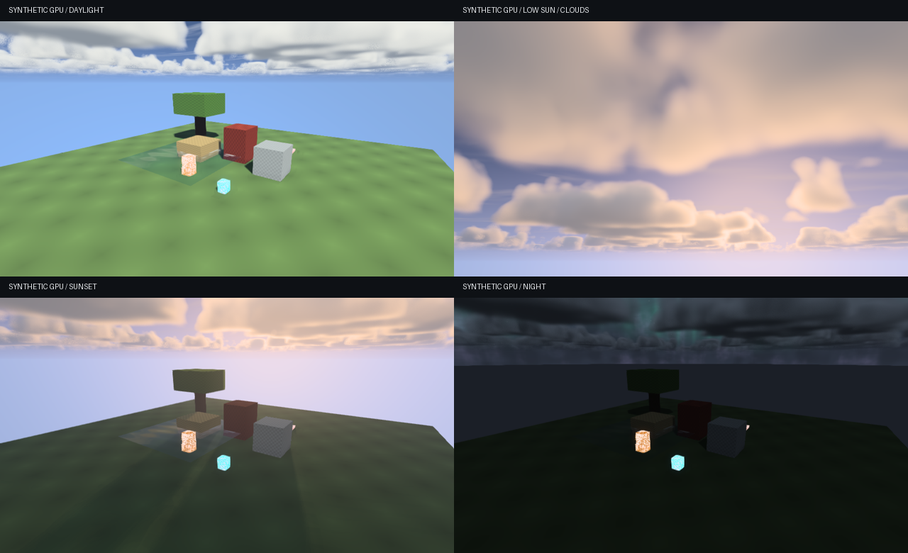

**1.12.3 晴天清晨修复：** 修复「晴天清晨/傍晚看起来和阴天一样」。体积光的各向同性散射常数项在低太阳角度下把整个天穹铺上暖白色，且光柱项没有按视线方向加权；晨昏雾系数过大，晴天清晨能见度只剩约四分之一；云量还会被当作阴天来压暗阳光与天空。现在体积光天空侧的各向同性项降到约 1/8、光柱按前向相位 `0.10 + 0.90·cos²` 加权（朝太阳的丁达尔光柱不变），晨昏高度雾/山谷雾密度与暖霾混合比例减半，云量只增加云而不再压暗光照，云密度阈值与卷云权重同步收紧。新增「大气」页参数 `DAWN_HAZE`（0 / 0.5 / 1 / 1.5 / 2，默认 1）：0 为通透晴天，2 恢复浓厚晨雾。

**1.12.1 参数对齐（参考 Photon 1.3 的默认值）：** 环境光遮蔽世界半径改为 2.0 格、高档采样由 18 次降为 12 次；PCSS 阴影对齐「3 次遮挡搜索 + 6–12 次滤波」区间，高档每个受光片元的阴影采样由 20 次降为 14 次；水体采用 Photon 的每格吸收系数（水柱 0.39/0.14/0.07，水下 0.20/0.08/0.04），深水不再压向黑色、水下能见度更高更偏蓝绿；体积光参考其晨昏光束步数分布，仰角超过约 17° 后采样减半。这些都是本项目自行实现的等效参数，没有复制其代码。

**1.12.0 末地重做与 Photon 方向性能优化：** 末地中央天体不再是黑洞/虫洞。原「事件视界 + 光子环 + 吸积盘」被替换为**裂隙核心**：多面水晶核心、四条长衍射星芒、两道对向等离子喷流，以及两条由角向扇区驱动的碎裂石片带（每片石片独立哈希半径、厚度与色调，部分扇区留空）。整体为棱角与分段剪影，和圆形视界加平滑尘埃盘的构图不同；巨行星的临边辉光与行星环也改为冷紫银色调，与新的紫色环境光一致。反射、云、水体与体积光的预算重新平衡：云层改为远段细节降级（保留近处云形与自阴影）、直接天空步数 16/24/36、云内光照用更长步距的两次采样替代三次短采样；反射不再二次体积云 march，改用单层云面近似；水面反射默认为天空解析反射，屏幕空间命中改为 `WATER_REFLECTIONS` 选项（极高/电影级默认开启）；水面折射由多点偏移采样替代多点模糊。累计与 1.11.2 的 1280×720 HIGH 合成 A/B：云 -37.2%、日落 -37.3%、白天地表/水面 -36.9%、雨天 -51.0%、水下 -36.6%，云/日落/白天/雨天平均 8-bit 差异 0.73–1.18，水下 2.99（吸收系数改动的可见结果），水面绘制耗时下降约 90%。数据见 `validation/performance-report.json`，不等同于游戏 FPS。

**1.11.2 主世界性能优化：** 保留直接天空的云层、云形细节、阴影分辨率、体积光和 SSR；中高档云内阴影使用低频密度和细节均值，倒影云层使用一半步数。彩色光先剔除非发光像素，间接光跳过零贡献采样。

**1.11.1 / 1.11.0：** 删除旧的六颗末地行星与轨道尘埃，只保留带环巨行星、中央天体与固定星空；云改为三维密度云团与细节侵蚀。1.12.0 已把当时的黑洞/虫洞中央天体替换为裂隙核心。

先选择 **HIGH**；需要更细的云可选择 **ULTRA**。晨昏效果需要低太阳角度和树木/地形遮挡，暖色雨天需要游戏正在降雨。预览为实际着色器生成的合成 GPU 场景，不等同于 Minecraft 截图，也不承诺逐像素复现参考图。

**交付状态：首轮功能实现，已通过独立 GPU 编译和合成场景渲染检查，尚未完成 Minecraft + Iris 游戏内验收。** 本项目没有实测游戏 FPS 数据，也不宣称已经覆盖所有显卡或模组组合。

## 效果预览

1.12.1 合成 GPU 预览（非游戏截图）：

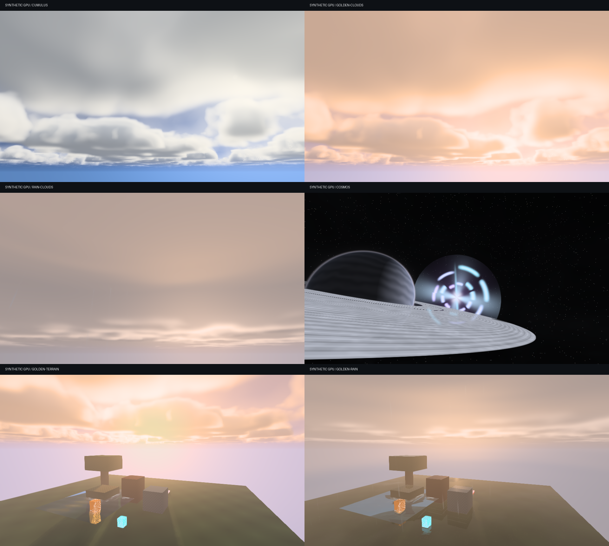

**1.5.0 更新（天气与大气）：** 新增独立程序化降雨 pass，以游戏降雨几何为承载，重新生成具有风向、层次、远近密度和雷光响应的雨线；水面加入多尺度扩散/衰减圆形雨纹，向上且受天空光照的方块表面加入细小 splash。石材、道路、木材与树叶会随 Iris `wetness` 平滑变暗、降低粗糙度并增强反射。云、天空、太阳、雾、地形、水面和体积积累会共同响应 Clear / Cloudy / Rain / Thunderstorm。晨昏体积光使用阴影贴图沿视线积分，并借助明暗样本变化形成穿过树冠缝隙的光柱；正午自动降低且限制最大能量。地形雾组合高度雾、低地/山谷噪声与远景霾，并由场景深度截止，因此不会穿过前景墙体。

**1.6.0 更新（体积云、彩色光、彩虹与每日天空）：** 主世界云层升级为体积云 ray-march，雨/雷暴时云底降低、厚度增加，并带向太阳自阴影与银边；低档保留单层云后备。新增屏幕空间彩色光源，发光方块会向可见表面投射其颜色，由 `COLORED_LIGHT_QUALITY` 控制。新增雨后彩虹，并让天空、云量与雾密度按日历日变化，连续日期不再完全相同。

**1.7.0 更新（宇宙天空与末地行星）：** 末地行星扩为七颗，轨道从内到外显著拉开，远近角尺寸和公转速度差异明显；行星自转与公转解耦，每颗行星独立旋转。主世界夜空新增倾斜银河带与彩色星云、北向低空极光、偶发流星，以及一颗带色带的远距行星，由 `COSMIC_SKY_QUALITY` 控制。

**1.7.1 更新（极光与流星调整）：** 移除主世界夜空的远距淡行星；大幅加强北向极光的亮度、高度与帘幕层次，并提高流星出现概率。

**1.7.2 更新（柔和光线）：** 降低自动曝光增益、直射阳光、白昼环境光和方块光照，同时抬高泛光阈值并减弱泛光强度，整体更柔和、不易过亮发白。

**1.7.3 更新（体积云融合）：** 优化体积云密度曲线，使用更宽的软阈值和双层软叶分布，加入天空环境色与地平线/远景柔和过渡，让云层更自然地和天空融合。

**1.7.4 更新（水体与水下可见度）：** 雨天/风浪时水面折射扩散模糊并提高反射占比，站在岸上朝水里看更难看清；水下视野增加距离模糊和更强的吸收，水面上方与陆地随深度更快失焦、更浑浊。

**1.8.0 更新（四季更替）：** 新增 `SEASON_MODE`（Auto / 春 / 夏 / 秋 / 冬）与 `SEASON_STRENGTH`。自动模式随日历年份推进，季节会连续影响天空、阳光、环境光、雾、云量和植被颜色；也可手动固定某个季节用于截图或主题世界。

**1.8.1 更新（末地天体重做）：** 七颗行星的轨道距离与尺寸反差加大；每颗行星沿轨道加入尘埃碎屑带。行星未受光面加入环境补光，避免暗面像黑洞。中央恒星改为单一虫洞（暗事件视界 + 光子环 + 倾斜尘埃吸积盘），带环巨星的光环改为多层径向带与噪声碎块。

**1.9.0 更新（天象事件与群系氛围）：** 新增 `CELESTIAL_EVENTS`：按日历出现流星雨、彗星、极光风暴、日食与稀有超新星。新增 `BIOME_BLEND`：用温度与降雨驱动区域差异——沙漠热霾、丛林/沼泽湿雾、寒冷地区偏冷蓝且更容易出现极光。

**1.9.1 更新（水体与洞穴深度）：** 水下新增蓝绿色体积光柱与流动焦散，岸边加入随风起伏的泡沫带，水体折射加入更强深度视差；洞穴新增微弱生物荧光与漂浮微尘，黑暗洞穴更有层次。

**1.10.0 更新（粒子、云型、扩展天气与地表季节）：** 新增 `PARTICLE_LAYER`（花粉/尘埃、萤火、孢子、雪粒、冰雹、余烬、宇宙尘埃）、`CLOUD_TYPES`（积云/层云/卷云/砧状云）、`WEATHER_EFFECTS`（沙尘暴/暴雪/雾团）与 `SURFACE_SEASONS`（冬季霜雪、斑驳秋叶、雨后水洼、夏季热浪）。

**1.4.0 更新（稳定性与时域渲染）：** 新增可调 TAA 历史缓冲、相机/深度/屏幕拒绝和 3×3 YCoCg 邻域裁剪；阴影升级为接触硬化 PCSS；AO 改为世界半径限制的方向性地平线搜索；SSR 增加自适应步进、厚度判断、命中置信度与粗糙反射；加入 Legacy Filmic、类 ACES、类 AgX 三种色调映射，并收紧自动曝光与泛光。体积光在 TAA 开启时使用低差异帧抖动。投影 jitter 暂未启用，以避免破坏手部渲染和 Iris 兼容性。

末地裂隙核心与巨行星特写：

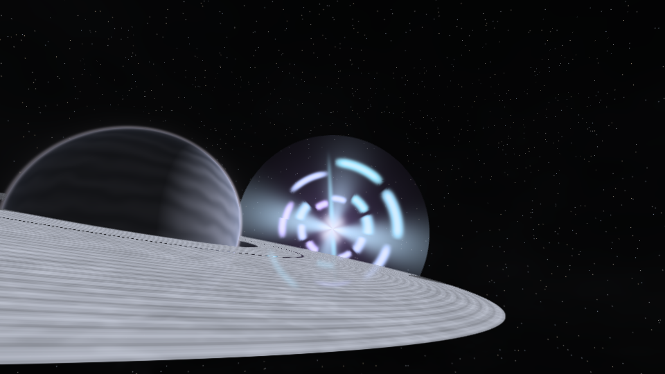

**1.3.0 更新（末地行星视觉升级）：** 四颗末地行星改为独立轨道与观感——内圈行星公转更快、外圈更慢，轨道距离与视尺寸各不相同；环巨星的光环随自身半径成比例缩放。每颗行星新增程序化大气辉光：轮廓处最亮并向外指数衰减为柔和尘雾，内侧只在贴近边缘处保留窄辉光；辉光颜色按行星类型区分（冷蓝、火山橙、琥珀、冰蓝），朝向中央恒星的一侧更强，形成“光从行星一侧溢出”的方向感。已重新通过完整 GPU 编译矩阵、九类合成场景离屏回归与末地天空夹具检查；Minecraft 游戏内验收与 FPS 实测仍待进行。

**1.2.0 更新（性能优化）：** 主世界云阴影从逐像素 FBM 改为逐顶点计算并插值，几何渲染阶段不再为每个片元重复求值；水体透明片元改为先判定水体后提前结束，避免先计算一遍普通光照再被覆盖；远距离阴影 PCF 采样降至 4 次（超出 60% 阴影距离后），配合原有阴影淡出。三项改动已通过完整 GPU 编译矩阵与九类合成场景离屏回归；Minecraft 游戏内验收与 FPS 实测仍待进行。

**1.1.0 新增（末地行星天空）：** 末地新增程序化行星天空——四颗公转行星（含一颗带环巨星）、中央恒星与固定星空，由视线方向与时间驱动缓慢公转与自转。新增 `END_PLANETS`（开关）与 `END_ORBIT_SPEED`（0 / 0.5 / 1 / 2 倍速度）设置，位于「末地星空」菜单页，默认开启，仅影响末地维度。已在合成场景 GPU 夹具上验证 6 项检查（前景遮挡不变、轨道运动、静止一致性、时钟归零一致、关闭后静态、不泄漏至其他维度）；Minecraft 游戏内验收仍待进行。

**1.0.1 修复说明：** 已修复 1.0.0 在 Iris 清屏颜色配置解析阶段的加载崩溃。用户日志在 Minecraft 26.1.2 / Iris 1.10.9 / Sodium 0.8.12 上复现了该错误；修正后的四项清屏颜色已由实际 Iris 1.10.9 和 1.11.2 发布包解析通过。26.1.2 的完整画面兼容性仍需重试验收，这项修复不等同于全部游戏场景已通过。

**1.0.2 修复说明：** 将缓冲区格式元数据移入 Iris 支持的多行注释，解决 `deferred.fsh` 的 RGBA16F / RGBA8 / R11F_G11F_B10F 未定义错误；修正验证器，使其不再补入发布包没有的格式宏。已确认 Iris 仍会按预期分配全部 7 个缓冲区。

## 环境要求

- 目标游戏：Minecraft Java Edition **26.2**。
- Fabric + **Iris 1.11.2 对应的 26.2 Fabric 构建** + **Sodium 0.9.1 对应的 26.2 构建**。
- OpenGL 3.3 / GLSL 330 或更高版本的兼容功能，由 Iris 转换为游戏使用的核心管线。
- 本轮 GPU 验证设备：NVIDIA GeForce RTX 5080 Laptop GPU，驱动 616.64，OpenGL 4.6。
- 没有宣称支持 Minecraft 26.3、Vulkan、OptiFine、Distant Horizons、Voxy 或自定义渲染模组。

Iris 的 26.2 正式构建已在[官方 Modrinth 发布页](https://modrinth.com/mod/iris/version/1.11.2%2B26.2-fabric)核实。其发布包中的 `UndoReverseZ*` 兼容层会在启用光影时恢复传统深度约定；本包依此使用 OpenGL 深度重建。版本信息核对日期：2026-09-06。

## 安装

1. 安装 Minecraft Java 26.2 及相应的 Fabric、Iris、Sodium。也可以使用 [Iris 官方安装器](https://irisshaders.dev/download/)选择对应游戏版本。
2. 将 **Galaxy Shader-1.15.39.zip** 直接放进该游戏实例的 `.minecraft/shaderpacks/`，不必解压。
3. 启动对应 Fabric 实例，打开 `Options → Video Settings → Shader Packs`。
4. 选择 `Galaxy Shader-1.15.39.zip`，点击 `Apply`。
5. 打开光影设置，选择 `HIGH` 或 `MEDIUM`。界面提供中文与英文标签。

源码文件夹同样可安装：将整个 `Galaxy Shader` 目录放进 `shaderpacks/`，确认路径为 `shaderpacks/Galaxy Shader/shaders/shaders.properties`。ZIP 内则直接是 `shaders/`，没有重复目录。

## 已实现功能

| 系统 | 实现 |
| --- | --- |
| 光照 | 动态太阳/月光方向、日出日落暖光、天气衰减、半球环境光、洞穴最低环境亮度、手持光源近似 |
| 阴影 | 稳定网格的单张正交阴影贴图、PCSS blocker search、接触硬化可变半影、静态旋转采样、远距离降采样与淡出 |
| 天空 | Rayleigh/Mie 相位与光学厚度近似、太阳/月亮圆盘、星点、昼夜渐变、主世界银河带与星云、极光、流星、按日历发生的天象事件、反日点地影与金星带、黄道光、夜间黄道带/对日照、夜间气辉、22° 冰晶晕与幻日/日柱、46° 冰晶晕与环地平弧、日落绿闪、反日点光辐条 |
| 末地天空 | 裂隙核心（多面水晶核心、四条衍射星芒、对向等离子喷流、两圈碎裂石片带）、一颗带环巨行星与固定星空；`END_PLANETS`/`END_ORBIT_SPEED` 控制，仅末地启用 |
| 云与天气 | 体积云 ray-march（远段自动降低噪声细节，低档保留单层后备）、积云/层云/卷云/砧状云云型切换、夜光云高空云带、冬季珠母云、沙尘暴/暴雪/雾团、雨线、雨后彩虹、雨夜月虹、每日天空变化、平滑湿润累积、方块 splash、真实闪电事件照明 |
| 大气粒子 | 白天花粉与尘埃、夜晚萤火、森林孢子、雪群系雪粒、雷暴冰雹、下界余烬、末地宇宙尘埃；按群系/季节/天气/维度切换 |
| 水体 | 多频率动态波法线（最多三层）、多尺度扩散衰减雨纹、风雨扰动、雷暴高光、Fresnel、解析天空反射（`WATER_REFLECTIONS` 可选叠加屏幕空间命中）、单次偏移折射加一次附加采样、Beer–Lambert 吸收、岸边泡沫、水下焦散与蓝绿体积光、深水雾 |
| 表面反射 | 湿润或 LabPBR 光滑表面 SSR；自适应步进、厚度/交点细化、命中置信度、低成本粗糙反射、环境回退 |
| 植被 | 草、花、农作物、树叶、藤蔓；世界坐标与阵风驱动；双层植物上下段及阴影使用同一动画 |
| AO/间接光 | 方向性 GTAO 风格地平线搜索、世界半径与边缘感知权重；独立的有限距离颜色传递 |
| 材质 | LabPBR 法线、线性粗糙度、介电 F0/金属、材质 AO、发光读取；无资源包时使用原版材质参数 |
| 发光物 | 火把、灯笼、灵魂光源、熔岩、红石、海晶灯、末地烛、营火、点燃熔炉等分类发光；发光表面向可见几何投射屏幕空间彩色光 |
| 大气雾 | 地形深度遮挡的高度雾、低地/山谷雾、远景霾与天气湿度响应，并按群系温度/降雨改变雾色与浓度；下界暖色火山雾；末地暗色星云和虚空雾 |
| 体积光 | 阴影贴图 ray marching、树冠明暗变化光柱、晨昏增强/正午抑制、云遮挡与雷光散射 |
| 后期 | HDR 亮度筛选、受控泛光、Legacy Filmic / 类 ACES / 自然电影曲线、有界曝光、自然白平衡 |
| 相机 | TAA 重投影、历史拒绝、YCoCg 邻域裁剪；可选轻量 FXAA、景深与相机动态模糊 |

## 推荐设置与性能档位

默认 `HIGH`：2048 阴影、128 格距离、柔和阴影、适度反射和泛光。建议先使用 1080p、16 区块渲染距离，再按实际帧率调整。下面是质量预算，不是性能保证。

| 档位 | 阴影贴图 / 距离 | 效果预算 |
| --- | --- | --- |
| POTATO | 1024 / 64 | TAA/PCSS/SSR/AO/间接光/体积光/高级天气与地形雾关闭，四采样 PCF |
| LOW | 1024 / 96 | 低档 TAA、AO、雨纹和地形雾，PCF；SSR、间接光和体积光关闭 |
| MEDIUM | 2048 / 96 | 中档 TAA/雨天，低档 PCSS/GTAO/SSR/体积光/地形雾 |
| HIGH | 2048 / 128 | 默认；高档 TAA/天气，中档 PCSS/GTAO/SSR/体积光/地形雾；云 24 步；水面反射为天空解析反射 |
| ULTRA | 4096 / 192 | 最高天气与地形雾，更高 PCSS/GTAO/SSR/体积光采样数；云 36 步；水面加入屏幕空间命中 |
| CINEMATIC | 8192 / 256 | 16+24 PCSS、最高天气/大气/屏幕空间预算并开启截图景深；水面加入屏幕空间命中 |

降低 `SSR`、`Volumetric Light`、`Cloud quality` 和阴影分辨率通常最直接地降低成本。水面反射选择「仅天空反射」比「天空 + 屏幕空间」便宜很多，追求帧率时保持默认即可。`8192` 的 32 位深度贴图单张就约 256 MiB；Iris 还会使用其他渲染目标和缓存。不要将 CINEMATIC 当作默认游戏设置。

## PBR 资源包

`LabPBR materials` 默认 **Auto**：只在资源包通过 `texture.properties` 声明 LabPBR 时读取附加材质贴图。没有资源包时不采样这些贴图，避免错误默认纹理造成异常高光。

若你确定资源包是 LabPBR 1.3，但它没有声明格式，可选择 **Force LabPBR**。不要对普通资源包强制开启。`_n` 读取 RG 法线和 B 通道 AO；`_s` 读取 R 光滑度、G 反射率/金属、A 发光，255 的发光 Alpha 被正确忽略。未实现视差遮蔽、位移和次表面纹理通道。

## 已知边界

- 实机验收仍待进行；GPU 测试使用合成方块场景，不包含 Iris 运行期着色器转换、真实区块流式加载、游戏 UI、模组互操作或玩家输入。
- SSR 只能反射当前画面内的**不透明**场景；屏幕外使用环境近似。水的折射以不透明场景为背景，多层玻璃/水的折射不做递归求解。
- 水面默认只做天空解析反射（`WATER_REFLECTIONS` = 仅天空），因此水中的树木、山体等屏幕内物体不会出现在水面倒影里；选择「天空 + 屏幕空间」会开启这类命中反射，同时明显增加水面开销。
- 使用单张阴影贴图，不是级联阴影；薄玻璃/水不投射有色阴影。远阴影淡出后用天空光遮蔽减少室内漏光，极端地形仍需实机检查。
- 环境间接光和发光方块使用近似。原版方块光照贴图没有源颜色；本包新增的彩色光来自可见发光表面的屏幕空间传播，无法照亮屏幕外或被完全遮挡的光源，不能等同于 Photon 的体素 flood-fill / 有色 GI。
- 主世界云为体积云 ray-march，但仍使用屏幕空间/视线积分，不是 3D 体素云；云层对距离较远的采样只保留大尺度云团形状，飞越云层、世界坐标重置及远距离移动的观感尚待实机验证。
- Minecraft/Iris 直接提供 Clear、Rain、Thunder 与连续的 `rainStrength` / `wetness`；本包的 Cloudy 氛围由云量、湿润残留和遮光连续推导，并不是新增游戏天气类型。地表 splash 以天空光与表面朝向判断暴露程度，复杂屋檐下的逐雨滴遮挡仍是近似。
- TAA 不修改投影矩阵，因此没有子像素 jitter；动态实体没有独立运动向量，主要依靠深度、亮度与邻域拒绝控制残影。自动曝光仍来自 Iris 平滑眼部光照，而不是全画面亮度直方图。
- 地形和方块实体支持材质法线；普通实体/装备没有完整 LabPBR 读取。命名金属的直射高光使用相应 F0，环境反射采用 Albedo 金属近似。
- 默认不模糊 HUD；后处理发生在世界画面上。手持物有独立屏蔽标记，但 GUI、第三人称、附魔光、信标及特殊物体仍需 Minecraft 内验收。
- 发光区域通过材质贴图或方块类型/亮度阈值近似，熔炉侧面等局部纹理的发光精度不及专用 PBR 发光贴图。

## 故障排查

- **列表里找不到**：检查是不是放入当前启动器实例的 `shaderpacks/`，并检查 ZIP 根目录是否有 `shaders/`。
- **编译报错/黑屏**：先关闭光影恢复画面，确认使用 26.2 对应的 Iris/Sodium 构建。保留 `.minecraft/logs/latest.log` 中的首个 Shader 错误、显卡型号和所用预设，便于定位。
- **材质过亮或反光异常**：将 `PBR_MODE` 设为 Auto 或 Off，检查资源包是否确为 LabPBR。
- **帧率低**：切换 MEDIUM/LOW，降低反射、体积光、阴影距离，关闭景深/动态模糊。
- **截图太暗/太亮**：调整 Exposure；需要固定曝光时关闭 Eye Adaptation。
- **清晨/傍晚发灰，像阴天**：先看「大气」页的 `晨昏雾霾`（`DAWN_HAZE`），默认 1，设为 0 会得到通透的晴天，2 则是浓雾晨景；再确认「云层」页的 `云量` 没有开得太高——云量现在只增加云，不会再把阳光和天空一起压暗。
- **反射在屏幕外缺失**：这是屏幕空间反射的范围限制；包内已有环境回退。

## License / Credits

自行编写的光影源码与文档按 [MIT License](LICENSE) 发布。没有复制其他光影包的 GLSL 或贴图；发布 ZIP 不包含 Minecraft、Iris、Sodium 或第三方资源。

接口参考：[Iris 文档](https://shaders.properties/current/)、[LabPBR 规范](https://shaderlabs.org/wiki/LabPBR_Material_Standard)。光照使用公开的 Fresnel、GGX、Rayleigh/Mie、Beer–Lambert 等数学模型；Filmic 曲线采用常见的 ACES 拟合形式，不是完整 ACES 色彩管理管线。

项目结构和验证流程见 [ARCHITECTURE.md](ARCHITECTURE.md)，本轮变更见 [CHANGELOG.md](CHANGELOG.md)。
